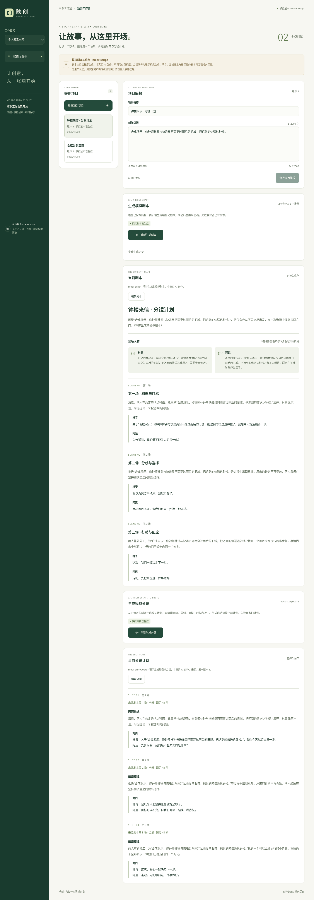
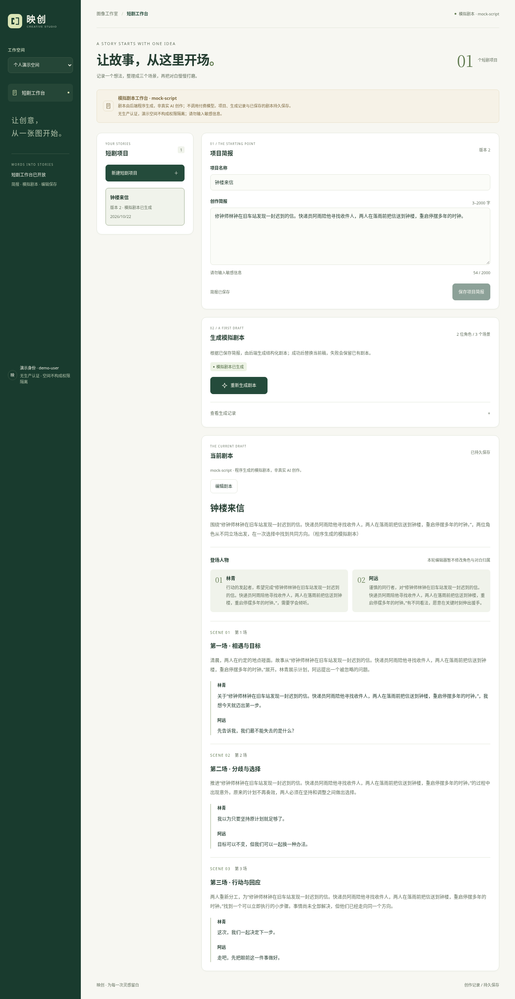
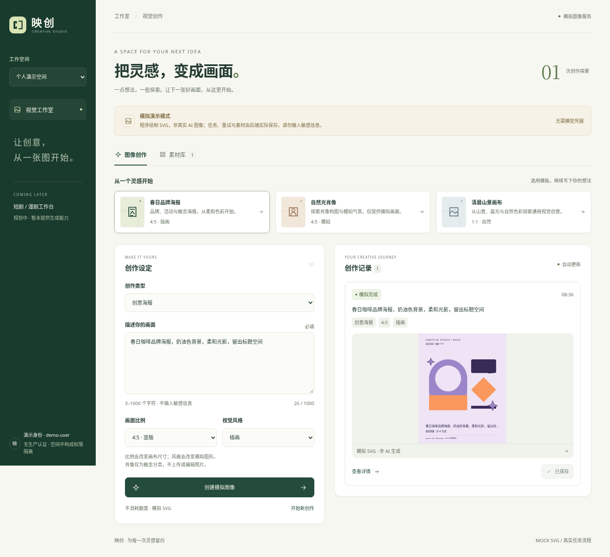
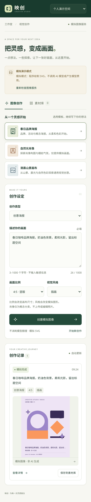

# 映创 · AI Creative Studio

面向个人与团队的 AI 视觉内容工作室。React / TypeScript / Vite 前端与 Go / Eino 后端独立启动。第五轮已发布基线为 `2ff0b9260471d3ac6b248ee8ce07e16b4cdf9447`；第六轮在此基础上推进真实创作协议与本地短剧成片链路。后续已获授权在验证后推送默认分支并通过CI发布Docker镜像；实际发布状态以Actions为准，应用没有因此部署。

**默认无凭据、无付费调用。模拟文本、模拟图像及合成音视频必须保留来源标识；本地假上游验证不等于真实模型质量或费用验证。** 用户要求可替换适配器覆盖 OpenAI、Claude、Gemini、字节、MiniMax、即梦及 Nano Banana 相关生态；须区分厂商、模型与消费产品，仅使用官方 API。具体模型、账号和预算尚未提供；能力矩阵须明确支持、未支持及需授权项目，适配实现不代表远端验证。演示空间没有身份认证，不应暴露到公网。

## 第六轮：创作适配与本地成片

- 需求分析与澄清、可替换文本适配；结构化剧本/分镜继续经过校验，生成来源与配置状态分开显示。
- 镜头增删、排序与保存；剧本/分镜历史查看和回滚，回滚产生新版本。
- 上传 PNG/JPEG、WAV/MP3 或 H.264 MP4，并关联角色或镜头；照片可在浏览器旋转或居中裁为正方形，保存为新 PNG 素材。
- 时间轴支持逐镜排序、时长、视频起点、逐句字幕起止时间、单镜配音/音效及音量，另有全片背景音乐。原视频音轨不自动保留，需另附音频。
- 本地 FFmpeg 合成 640×360、24fps H.264/AAC MP4；提供网页预览、下载及 SRT 字幕。内嵌字幕为可选字幕轨，不是烧录到画面。

OpenAI/Gemini/方舟/MiniMax图像适配支持将已上传角色参考作为图像输入；角色选择用于资产关联，角色描述需写入创作提示；仅适用于支持相应协议的已配置模型，属于尽力参考，**不能保证跨镜头人物外观一致**。Google 图像/Nano Banana 分别提供 `generateContent` 与 Interactions 适配，须选择与配置模型相符的协议，不保证任意未来模型兼容。照片编辑是本地旋转/裁剪，不等于供应商图像编辑或身份保持。时间轴是有界 MVP，不是专业多轨剪辑器。

本轮范围与阶段验收见 [产品](docs/iteration-6-product.md)，接口和安全边界见 [架构](docs/iteration-6-architecture.md)，角色分工见 [协作](docs/iteration-6-collaboration.md)。最终追加代码的检查结果与未完成项见 [追加验证记录](docs/iteration-6-followup-verification.md)，[原验证记录](docs/iteration-6-verification.md)保留第一阶段已验收快照。后文第三至第五轮说明是历史增量记录，其当时的功能限制不应替代当前实现。

### 已实现的供应商能力

下表表示本项目已有协议代码，**均未进行真实账号、模型效果或费用验证**；“—”表示未提供该适配，不等于供应商没有相应产品。模型 ID 和权限须由操作者明确选择。

| 官方生态 | 文本创作 | 图片理解 | 图像生成 | 图像参考输入 | 镜头视频 | 语音 |
| --- | --- | --- | --- | --- | --- | --- |
| OpenAI | 已实现 | 已实现 | 已实现 | 已实现 | 已实现 | 已实现 |
| Anthropic / Claude | 已实现 | 已实现 | — | — | — | — |
| Google / Gemini / Nano Banana | 已实现 | 已实现 | 两种协议已实现 | 两种协议已实现 | Interactions已实现，仅文生视频 | Interactions已实现 |
| 字节 / 火山方舟 / 豆包 | 已实现 | 已实现 | 已实现 | 已实现 | 已实现，含首帧 | 独立豆包TTS已实现 |
| MiniMax | 已实现 | 已实现 | 已实现 | 单角色参考已实现 | 已实现，含首帧 | 已实现 |
| 即梦公开视觉 API | — | — | AK/SK签名已实现 | 未接入：官方仅URL参考 | 未接入：旧版下线 | — |

图片理解使用已上传PNG/JPEG与文本模型，输出创作分析，不用于确定人物身份；所选文本模型须实际支持图片输入。参考输入属于尽力条件生成，不是锁脸或通用mask局部编辑。Google图像区分 `gemini-images`（generateContent）与 `gemini-interactions-images`（Interactions）；Google视频不支持本应用首帧输入。即梦4.6参考图需要外部可访问URL，当前没有获授权的公网素材桥接，未将本地文件或伪造URL送入接口；旧视频接口不冒充仍可用。

字幕同步提供三条明确路径：按文本长度估算（不识别音频）、OpenAI ASR时间戳候选、人工逐句起止时间。ASR默认不可用，只适配 `whisper-1` 的verbose_json时间戳协议；候选需要用户应用并保存，不自动覆盖时间轴，准确性未真实验证。音乐/音效使用上传素材和混音，没有生成式音乐模型。

### 无凭据本地成片路径

启动前后端后创建短剧项目，保存需求并生成模拟剧本和分镜。在「素材与成片」上传素材，或点击「创建合成演示素材与时间轴」；后者创建色块图片、合成正弦音和字幕，明确不是模型生成或真人配音。调整时间轴、保存，再点击「合成并导出 MP4」。状态完成后可预览和下载。也可逐镜生成媒体，按每条记录的来源区分模拟与真实协议。

本地合成需要 `ffmpeg`、`ffprobe` 可执行程序。上传单文件最多 32 MiB，图片最多 2000 万像素且单边不超过 8192；音视频最多180秒，视频不超过3840×2160。每项目最多120素材/30导出，时间轴1–30镜、每镜0.5–30秒、总长最多180秒。当前全局限制2个上传、2个合成和2 GiB媒体容量。限制以服务端为准。

## 第五轮增量

- 从已保存剧本异步生成 `mock-storyboard` 分镜计划；每项目保留一份当前计划。
- 逐镜编辑画面、场景序号、景别、运镜、时长与对白，显式保存到真实后端；刷新与重启后可读取。
- 分镜记录来源剧本版本，剧本编辑或重新生成后提示过期；编辑旧分镜不会消除过期提示。
- 生成失败保留旧计划；生成期间锁定项目写操作，版本冲突保留本地草稿，结果不确定时使用原请求与幂等键重试。
- 仍不提供分镜图像、真实文本模型、镜头增删界面、时间轴或视频编辑器。

契约与数据升级见 [第五轮架构](docs/iteration-5-architecture.md)，实际检查与限制见 [第五轮验证](docs/iteration-5-verification.md)。

## 第四轮增量

- 短剧项目按演示空间创建、浏览和编辑，名称与创作需求真实保存至后端。
- 独立 `mock-script` 经 Eino 校验输入、生成两个角色和三个场景的结构化草稿、校验输出；状态与结果持久化。
- 编辑剧本标题、梗概和场景文本后显式保存；版本检查防止并发覆盖，所有写操作使用持久幂等记录。
- 生成失败保留旧稿；修改创作需求后展示旧稿来源提示，重新生成需明确确认覆盖。
- 不提供真实文本模型、分镜、音视频、成片导出、删除或剧本多版本浏览。

本轮范围及验收见 [产品](docs/iteration-4-product.md)、[架构](docs/iteration-4-architecture.md)、[界面](docs/iteration-4-ui.md)、[验证](docs/iteration-4-verification.md)、[角色协作](docs/iteration-4-collaboration.md)。完整阶段边界见 [路线图](docs/roadmap.md)；Actions Node 24 运行时维护依据见 [CI 说明](docs/iteration-4-ci.md)。

## 第三轮增量

- 修复桌面创作面板底边不齐及长页面侧栏背景提前结束，保留自然内容高度与移动单列布局。
- 增加固定官方 OpenAI Images 协议适配，保留默认 mock；能力接口区分模拟、真实协议配置就绪和配置不可用。配置就绪不代表远端认证或生成已成功。
- 真实 PNG 校验后保存到本地结果目录，任务与素材记录来源、模型及图片元信息；历史 mock 不会因当前模式变化而被标为真实生成。
- 真实请求不自动重试，执行中断不自动重新发送。显式重试可能再次计费，不能承诺上游 exactly-once。

详细范围、协议与最终验证分别见 [产品](docs/iteration-3-product.md)、[架构](docs/iteration-3-architecture.md)、[界面证据](docs/iteration-3-ui.md)、[独立验证](docs/iteration-3-verification.md)和[协作记录](docs/iteration-3-collaboration.md)。

## 第二轮业务增量

- **后端模板目录**：海报、肖像概念、通用图像，比例/风格选项来自 API；所有输入由后端校验，任务与素材持久化参数。
- **可核对的任务详情**：直接读取任务详情 API，展示完整设定、阶段、失败原因及重试来源。
- **真实失败重试**：编辑后通过重试 API 创建关联原任务的新记录并排队执行；原失败记录保留，同一次请求幂等重放，不伪造前端成功。
- **后端素材检索**：关键词与类型组合查询真实持久化素材；查询失败、无匹配和空库分开显示。
- **统一映创品牌**：原创 SVG 标记、深浅背景字标与 favicon，统一设计 tokens、可访问组件及响应式工作台。

第二轮时图像 provider 仅为 mock；业务 API、任务执行、重试关联和持久化均真实运行。三种比例为 `1:1 / 4:5 / 16:9`，三种风格为自然 / 棚拍 / 插画。旧数据缺失参数时补 `4:5 / natural`，保留原 SVG。没有执行中任务取消功能；“取消编辑”和关闭详情不会取消后端任务。

产品、架构、前端、后端、测试五个实际子代理的职责和文件边界见 [协作记录](docs/iteration-2-collaboration.md)。验收范围见 [产品文档](docs/iteration-2-product.md)，接口与兼容设计见 [第二轮架构](docs/iteration-2-architecture.md)，最终验证见 [第二轮测试记录](docs/iteration-2-verification.md)，视觉规则见 [品牌与组件规范](docs/brand.md)。

## 实际运行截图

### 第五轮：可编辑模拟分镜计划

真实本地前后端，使用合成剧本；分镜为程序模拟文本计划，不是分镜图像或视频，也不是已部署服务。

[桌面原图](docs/screenshots/storyboard-desktop.png) · [手机原图](docs/screenshots/storyboard-mobile.png) · [36 状态布局证据](docs/screenshots/iteration-5-storyboard-geometry.json)



### 第四轮：短剧项目与结构化模拟剧本

以下来自真实运行的前后端，仅使用合成创作需求，剧本文本由程序模拟生成，非真实 AI 创作，也不是视频。图片是静态截图，不是已部署的交互网页。

[桌面原图](docs/screenshots/script-desktop.png) · [手机原图](docs/screenshots/script-mobile.png) · [30 状态布局证据](docs/screenshots/iteration-4-project-geometry.json)



### 图像工作台

以下第四轮图像工作台回归截图来自云开发环境中实际运行的前后端，仅包含合成演示数据。它们是静态截图，**不是可交互网页或已部署服务**；图像结果仍为带标识的模拟 SVG。

### 桌面：创建模拟图像与底边对齐

[打开桌面原图](docs/screenshots/desktop.png)



[修复前桌面截图](docs/screenshots/iteration-3-before-desktop.png) · [本轮 24 个状态的几何证据](docs/screenshots/iteration-4-image-geometry.json)

### 移动端：模板、参数与创作记录

[打开移动端原图](docs/screenshots/mobile.png)



第二轮留档 — 素材检索：[桌面](docs/screenshots/library-desktop.png) · [手机](docs/screenshots/library-mobile.png)

第二轮留档 — 任务详情：[桌面](docs/screenshots/detail-desktop.png) · [手机](docs/screenshots/detail-mobile.png)

## 目录

- `frontend/`：中文响应式界面、任务轮询、素材库、单元与 Playwright 测试。
- `backend/`：HTTP API、图像双节点与剧本三节点 Eino 流程、进程内 workers、持久化和恢复。
- `api/openapi.json`：OpenAPI 3.0.3 契约。
- `docs/architecture.md`：数据归属、扩展边界和生产能力缺口。
- `docs/iteration-2-verification.md`：第二轮实际验证结果；`docs/verification.md` 保留第一轮记录。
- `deploy/`：未来 PostgreSQL、Redis、MinIO 本地设施示例，当前应用不连接这些设施。
- `.github/`：CI、问题和 PR 模板。项目未添加开源许可证。

## Docker 本地运行

可使用 `docker compose build`、`docker compose up -d`，随后打开 `http://localhost:8080`。仅前端绑定宿主回环端口，Nginx同源代理后端；FFmpeg和中文字体包含在后端镜像中，项目与媒体保存在命名卷。详细步骤、备份边界和Docker Hub配置见 [Docker运行与镜像发布](docs/docker.md)。构建/发布结果以实际验证与Actions记录为准，镜像发布不等于应用部署。

## 本地开发

先决条件：Linux（文件存储使用 `flock`；macOS 可自行验证，Windows 建议 WSL）、Go **1.25.3**、Node.js **24**、npm **11**。Go 与 Eino 版本锁定以确保兼容；升级前须复跑测试。

终端一：

```bash
cd backend
cp .env.example .env
set -a; . ./.env; set +a
# .env 为可信本地配置，服务本身不自动读取 .env
go mod download
go run ./cmd/server
```

终端二：

```bash
cd frontend
cp .env.example .env
npm ci
npm run dev
```

打开 `http://localhost:5173`，API 为 `http://localhost:8080`，健康检查为 `/healthz`。从后端模板中选择一个起点，调整描述、比例与风格，创建模拟任务后查看详情并保存素材；在素材库按关键词和类型搜索。刷新或重启服务后已提交记录仍可读取。输入 `[mock-fail] 故障测试` 可验证失败路径；点击编辑重试并手动移除标记，可观察新任务执行与原记录保留。未提交的草稿不是后端记录。

服务默认仅绑定回环地址。**没有认证，任何能访问服务的人都能读写两个演示空间。不要暴露到公网或输入真实客户数据。** `space_id` 只演示数据归属过滤，不是安全边界。需要在云工作区访问界面时，通过平台已有端口转发访问；本项目不自动部署或创建公开预览。浏览器中的 `VITE_API_BASE_URL` 必须是浏览器可达的 API 地址，`FRONTEND_ORIGIN` 必须精确匹配前端来源。

本次云环境中 `/usr/bin/go` 不是 Go 编译器，可在后端命令前执行以下环境配置（工具链在临时目录，环境重建后需重新安装）：

```bash
export PATH=/tmp/studio-go125/go/bin:$PATH
export GOPATH=/tmp/studio-gopath
export GOCACHE=/tmp/studio-gocache
```

## 服务模式与安全配置

默认 `IMAGE_PROVIDER=mock-svg`，无需模型密钥。`GET /api/v1/capabilities` 返回模式和本地配置状态，前端据此展示生成入口；缺少密钥或配置无效时仍可查看历史记录，但不能创建新任务。已有请求的幂等重放保留原任务。

真实协议由服务端选择，模型 ID 需显式配置，不能从前端提交任意供应商 URL。文本、图像、视频和语音按各自能力选取；能力注册表区分已实现适配、未实现、不支持和需授权，不能用厂商有某能力推断本项目已接入。Claude 是 Anthropic 模型家族；Nano Banana 属于 Google/Gemini 图像生态；即梦消费产品、火山视觉签名 API 与方舟 Bearer API 不是同一接口。

配置说明以 [第六轮架构](docs/iteration-6-architecture.md)、`backend/.env.example` 及 `GET /api/v1/creative-registry` 的能力矩阵为准。本轮不配置任何真实密钥。未来实际调用前须确认模型/账号权限、预算和发送数据授权；不要在聊天、前端变量、源码或 Git 中填写密钥。

| 配置域 | Provider 取值 | 显式模型/额外设置 |
| --- | --- | --- |
| `TEXT_PROVIDER` | `openai-text` / `anthropic-text` / `gemini-text` / `ark-text` / `minimax-text` | `TEXT_MODEL` |
| `IMAGE_PROVIDER` | `openai-images` / `gemini-images` / `gemini-interactions-images` / `ark-images` / `jimeng-images` / `minimax-images` | `IMAGE_MODEL`；即梦改用 `JIMENG_REQ_KEY` |
| `VIDEO_PROVIDER` | `openai-video` / `gemini-video` / `ark-video` / `minimax-video` | `VIDEO_MODEL` |
| `SPEECH_PROVIDER` | `openai-speech` / `gemini-speech` / `bytedance-speech` / `minimax-speech` | `SPEECH_MODEL`；后三者另需 `SPEECH_VOICE` |

`ASR_PROVIDER=openai-asr` 另需显式 `ASR_MODEL=whisper-1`；默认留空。视觉理解复用 `TEXT_PROVIDER/TEXT_MODEL`。字节TTS的 `SPEECH_MODEL` 表示语音资源ID，与方舟模型不是一回事。

凭据变量按供应商分别为 `OPENAI_API_KEY`、`ANTHROPIC_API_KEY`、`GEMINI_API_KEY`、`ARK_API_KEY`、`MINIMAX_API_KEY`、`BYTEDANCE_SPEECH_API_KEY`；即梦使用 `JIMENG_ACCESS_KEY` 与 `JIMENG_SECRET_KEY`。这里只列配置项，本轮不填写或启用。运行默认使用 `mock-text`、`mock-svg`；语音、视频模型与ASR默认不可用，本地上传与合成演示仍可使用；未知配置或缺少模型/凭据时不可用，不悄悄回退为付费供应商。请求绑定预期 provider 和 model，防止界面旧配置误触发其他模型。

真实创建请求不自动重试或跟随重定向；调用固定官方目标，不使用环境代理。媒体下载仅允许经过公网地址和DNS校验的HTTPS来源；Google Files最多允许一次安全跳转，跨源下载不携带API密钥。超时、中断或无效响应不证明供应商未计费。真实执行重启后不会自动重发；显式新建生成可能再次收费。取消本地视频等待不保证供应商停止执行或计费。对于已持久保存上游ID的视频和即梦图像，显式恢复仅查询同一任务，不重新提交生成；尚未拿到或未能持久保存上游ID的结果不明请求不能靠重发冒充恢复。模式切换不改写历史来源。

这仍是无生产认证的本地演示服务；真实适配不补齐企业隔离、认证授权或生产用量治理，不能直接暴露到公网。真实模型质量、一致性、供应商认证与费用均未验证。

## 检查

```bash
cd backend
test -z "$(gofmt -l cmd internal)"
go vet ./...
go test -race ./...
go build -o bin/server ./cmd/server
cd ..
python3 scripts/smoke.py
cd frontend
npm ci
npm run lint
npm run typecheck
npm test
npm run build
npx playwright install chromium
npm run test:e2e
```

E2E 自动启动独立 API（8081）与前端（5174），使用新建临时数据目录，不读取开发数据。若已有系统 Chromium，可跳过下载：

```bash
PLAYWRIGHT_CHROMIUM_EXECUTABLE_PATH=/usr/bin/chromium npm run test:e2e
```

布局几何回归（从仓库根目录执行，自动使用隔离数据与随机端口）：

```bash
node scripts/layout_check.mjs
node scripts/provider_check.mjs
node scripts/project_check.mjs
node scripts/storyboard_check.mjs
```

系统 Chromium 可通过同一个 `PLAYWRIGHT_CHROMIUM_EXECUTABLE_PATH` 指定。该检查覆盖多个桌面宽度、短屏、单列断点、手机、空库及长文本，不使用开发数据。

Provider 联调使用本地 HTTP 假服务及合成 PNG，验证 Eino、落盘、重启、显式重试和过期模式保护，不调用外部模型或使用真实凭据。

OpenAPI 检查（建议在独立 Python 虚拟环境执行）：

```bash
pip install openapi-spec-validator==0.7.2
python -m openapi_spec_validator api/openapi.json
python scripts/contract_check.py
```

契约回归会编译当前后端，以临时数据目录和随机回环端口验证真实 HTTP 响应、重试执行、素材筛选与重启后幂等，然后清理进程和临时数据。

## 数据和恢复

`backend/data/state.json` 保存图像任务、历史模拟 SVG、素材元数据，以及短剧项目、当前剧本和分镜计划、生成记录和写操作幂等记录；真实 PNG 保存在同目录下的 `results/`；整个运行数据目录已加入 Git 忽略。`DATA_DIR` 可覆盖路径。任务先持久化再返回接受响应；mock 执行中任务在重启时重新排队，真实执行中任务转为结果不确定的失败，避免自动重复调用。写文件采用临时文件、文件 fsync、原子 rename，第二个进程无法锁定同一目录。状态损坏时启动失败，**不会清空重建**。停服后备份整个数据目录；要重置演示，请先备份，再显式移走该目录。

主项目继续使用 v3 文件快照，支持完整 v1/v2 数据受控升级，保留已有图像、项目、剧本与回执。升级前停服备份整个 `DATA_DIR`；旧版本程序不能直接读取 v3，回退须恢复对应备份，不要手改版本号。损坏或缺失必需字段仍拒绝启动。此升级不涉及数据库或外部服务。

只有无外部调用的模拟生成可安全恢复排队；真实图像和文本执行遵守中断不自动重发。媒体元数据、成片任务和创作任务另外持久化在同一 `DATA_DIR` 下，备份必须包含整个目录。未完成本地合成重启后标记失败，可显式新建导出；此前成功成片保留。历史回滚记录也需随数据目录备份。

当前不支持多实例、高可用、通用分页/删除、自动媒体回收或整机断电级事务保证。媒体硬限额不等于完整容量治理。详情见架构文档。在真实 provider 用于实际用户前，须完成认证授权、内容安全、成本控制、可观测性和生产存储迁移。本轮只验证适配协议与业务流程，不补齐这些生产能力。

## GitHub 协作

遵循 [CONTRIBUTING.md](CONTRIBUTING.md)，使用短生命周期分支和可审阅 PR，修改契约时同步实现、文档与测试。历史版本已发布至 `master`；本轮追加授权允许验证后推送默认分支并发布两个Docker镜像仓库；不包括真实模型调用或应用部署。仓库公开发布源码，不代表应用已部署或具备生产安全能力；未添加开源许可证。
