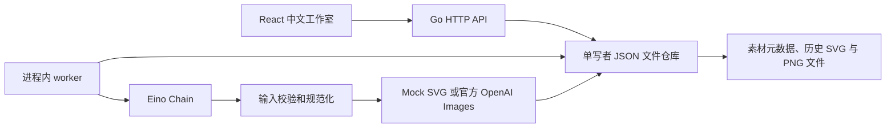

# 系统架构与边界

第二轮增加后端模板目录、参数、关联重试及持久化素材查询。第三轮增加一种官方真实图像协议与 PNG 文件存储，详细契约与恢复语义见 [第三轮架构](iteration-3-architecture.md)。以下基础设施限制继续适用。

## 当前可运行流程

Eino 实际编译和调用两个 Lambda 节点：Normalize 规范化并校验输入；ImageProvider.Generate 执行所选 provider。默认 mock 生成确定性、转义安全、带模拟标识的 SVG；真实适配器只调用固定官方协议并校验 base64 PNG。测试使用本地 HTTP 假服务，不代表真实模型质量验证。设计参考 [Eino 官方组合编排文档](https://github.com/cloudwego/eino#composition)。

API 输入也先验证，避免将无效任务放入持久队列；流程内部再次校验，使未来独立 worker 仍能验证自己的输入。进度只表示阶段：queued 0、running 35、终态 100，不代表真实模型百分比。mock 默认延迟 900ms 以便观察状态。

## 持久化与执行语义

`Repository` 是创建/查找/列举/领取/完成/保存素材的边界，当前仅 FileStore 实现。`ImageProvider` 是模型边界，包含默认 mock 与固定官方协议适配器。任务 ID 使用随机 128 位标识；每个任务和素材有 `space_id`。幂等键按空间范围持久化，同键同一规范化输入和父任务关联返回相同任务，同键不同输入、不同重试父任务或混用普通创建/重试返回 409。失败重试创建新任务并持久化 `retry_of`；原失败任务保持不变。素材 ID 等于任务 ID，因此重复保存无副作用。

单 mutex 保护进程内一致性；文件锁防止多进程同时打开；写入先构造新快照，写临时文件并 fsync，再 rename，成功后才替换内存快照。进程崩溃最多留下一个不可见临时文件。mock 执行中任务在下一次启动恢复为 queued；真实执行中任务转失败并标记结果不确定，不自动重复可能收费的请求。尚未执行的 queued 任务绑定原 provider/model，配置不匹配时安全失败。执行器持久化失败会使服务退出，避免继续接受任务但不再执行的假健康状态。

mock 恢复采用 **至少一次** 执行；真实协议无已验证的上游幂等或回执查询保证，因此不自动重试，也不承诺 exactly-once。显式重试可能再次计费，执行中断时须先由操作者核实供应商记录。当前单 worker 顺序执行，最长输入 1000 Unicode 字符，请求体最多 16KiB。文件仓库存储全部历史，列表没有分页；只适合小规模演示。目录 rename 后未额外 fsync 目录，整机断电可能丢失最近变更，不宣称数据库级持久性。需要停服备份；文件损坏时拒绝启动，由操作者从备份恢复。

## 个人与团队数据归属

当前内置 `personal-demo`（owner: demo-user）与 `team-demo`（owner: demo-team）。所有任务查询、结果读取和素材保存均按空间过滤，跨空间 ID 返回 404；接口测试覆盖此行为。浏览器切换空间会重新挂载页面，清空旧状态和取消旧轮询。

**演示空间完全公开，无认证、无成员关系检查。** 客户端可自由选择任一演示空间。CORS 只约束浏览器来源，不是授权。生产设计需 `users`、`organizations`、`spaces`、`memberships`，个人空间绑定用户、团队空间绑定组织，服务从经过验证的身份解析主体并检查空间角色，存储查询携带服务端授权的 space_id。对象存储路径应形如 `spaces/{space_id}/assets/{asset_id}`，并通过授权后的短期签名 URL 访问，不能依赖前端过滤。尚未实现 SSO、RBAC、租户级数据库策略、审计与企业隔离。

## 后续适配路径（均未接入）

1. PostgreSQL：替换 Repository；表包括 spaces、memberships、image_tasks、assets、outbox，约束 `(space_id,idempotency_key)` 与 `(space_id,task_id)` 唯一。事务提交任务与 outbox，避免数据库成功而消息丢失。
2. Redis / Asynq：将 outbox 事件投递至独立 worker。引入租约、退避重试、失败队列、超时、取消和可观测性；不能复用 FileStore 做多机队列。
3. 对象存储：第三轮 PNG 已保存到本地结果目录，历史 SVG 仍兼容内联存储；后续可迁移到对象存储，并完善对象提交与任务完成之间的孤立对象回收。目前没有远程对象存储适配器。
4. 短剧 / 漫剧：项目 → 创意分析 → 剧本 → 分镜 → 角色一致性资产 → 音视频生成 → 合成。可用 Eino Graph 编排长流程，但当前未提供这些 API 或生成入口。
5. 发布前：真实鉴权、用量限制、内容审核、隐私授权、图片上传校验、密钥托管、账单、故障恢复、依赖安全审查及负载测试。仓库公开不等于产品获准公开部署。

采用模块化单仓库而非多仓库，是为了让一个 PR 同步修改 UI、Go 实现和契约；仍然独立依赖、独立启动、独立构建。没有引入现阶段不需要的基础设施依赖或空服务。
