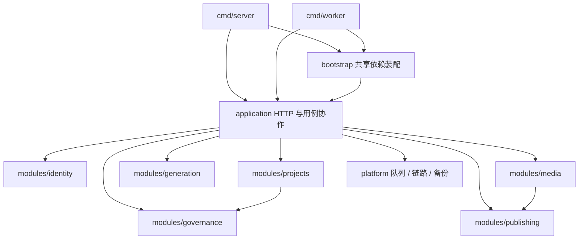

# 当前系统架构与边界

本页描述当前代码。各轮迭代文档保留当时的验收结果；目录和功能状态以本页及对应专题文档为准。

## 目录与依赖

前端是 React / TypeScript SPA，后端是 Go / Eino 模块化单体。API、独立 worker 和运维命令位于 `backend/cmd`。业务模型与纯规则位于 `backend/internal/modules`，跨模块执行与持久化协作位于 `application`，共享启动装配位于 `bootstrap`，队列、链路和加密备份位于 `platform`。

业务模块只依赖标准库和图中声明的业务值类型关系，不引用应用、数据库、HTTP 或供应商 SDK。依赖方向由 `internal/architecture` 测试约束。[完整目录与开发方式](../backend/README.md)

## 身份与组织

后端默认使用安全模式；公开演示模式必须显式配置 `AUTH_MODE=demo`。安全模式提供会话、组织成员角色与 OIDC 登录，空间选择必须经过服务端权限校验。演示空间仅是公开数据过滤条件，不是租户隔离边界。[认证与组织](authentication.md)

## 创作与发布

图像、剧本、分镜和其他媒体生成经过输入校验、显式模型选择与任务记录。模型配置就绪不代表凭据、权限、效果和费用已验证。远端执行须通过最新组织授权、请求报价、费用预留及审核；保存默认模型不自动触发收费调用。[模型管理](model-management.md) · [执行治理](execution-governance.md)

素材上传、时间轴、字幕、海报和本地导出使用当前媒体版本。社交发布区分下载准备、平台交接、平台草稿和直接发布；授权、素材权限和结果未知状态按各自流程处理。[媒体编辑](iteration-10-media.md) · [发布边界](iteration-10-social.md)

## 存储与执行模式

| 模式 | 数据与执行 |
| --- | --- |
| 文件 | 单写者 JSON 状态、本地结果文件和进程内 worker |
| PostgreSQL | 数据库状态与持久队列，API 与独立 worker 分离 |

存储配置失败时拒绝启动，不能静默退回文件模式。文件模式依赖单写者锁及原子快照；PostgreSQL 模式不能直接打开旧文件数据目录，迁移需要显式停写并使用新的目标。

PostgreSQL 中，接单记录、费用预留与队列任务使用同一事务提交；worker 完成使用租约 token 校验，并把领域结果与队列终态放入同一事务。未知结果或未知费用不能自动按免费处理，也不承诺供应商 exactly-once。[数据库与 worker](postgres-workers.md) · [迁移与备份](postgres-backup.md)

媒体文件通过 BlobStore 管理，支持本地存储与 S3 适配；跨主机运行 API 和 worker 需要共享对象存储，不能只共享数据库。[对象存储](iteration-8-object-storage.md)

## 本轮目录迁移的范围

原 `internal/studio` 的协作实现与现有测试迁移到 `internal/application`；项目、媒体、身份、生成、发布和治理的稳定模型、校验、金额及报价摘要规则提取到独立模块。类型别名保留原有应用调用入口、自定义 JSON 方法和错误身份。API 与 worker 的供应商配置经过同一个装配入口。

HTTP URL、JSON 字段、数据库 schema 和文件快照格式没有随目录迁移改变，现有前端和运维命令不需要迁移数据。

## 仍需继续治理的结构

`application` 仍包含供应商适配、HTTP、仓库实现与执行协作；本轮没有宣称这些边界已全部解耦。`FileStore` 仍承接文件与 PostgreSQL 模式，`stateMutex` 在数据库模式下仍隐式管理事务；scope 路径仍存在整表读取及全局 scope 行锁。

后续应按单个业务用例逐步提取仓库端口和显式事务边界，把按租户、项目、任务的查询下推数据库，并以真实 PostgreSQL 并发和故障测试验证。迁移必须保留接单、预留与入队的原子性，不能只把有关函数移到不同包中。
