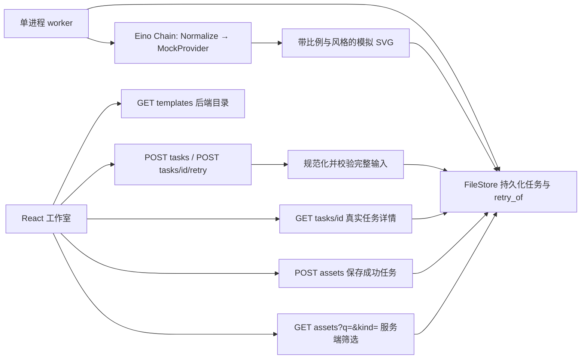

# 第二轮架构与 API 契约

本轮基于 `7284fab759ee6f59d1e75ab1b1c1dc13b34fba58` 扩展本地演示，契约以 [OpenAPI](../api/openapi.json) 为准。交付范围是后端模板目录与参数校验、持久化任务详情、失败任务的关联重试、持久化素材搜索筛选，以及相应前后端联调。图像生成仍由 Eino 实际编排调用 `MockProvider`，产物是带“非 AI 生成”标识的程序 SVG；业务接口、持久化、队列执行和错误处理真实运行。此文定义实现边界，验收结果另见测试记录。

## 业务链路与职责

后端是模板目录、合法参数、任务状态、重试关系、素材数据的唯一业务来源。前端从目录响应生成模板和选项，表单编辑只产生待提交草稿；选择模板、取消编辑或关闭详情均不声称已经创建/更新任务。创建、失败重试、保存必须以服务器结果确认。目录或素材请求失败须显示错误和可执行的重新请求入口，不得用前端固定列表或前端伪成功掩盖失败。

保留现有 `Repository` 与 `ImageProvider` 边界；仅为实际新增能力扩展仓库方法。文件仓库仍是单进程单写者，不新增数据库、队列或 provider 空模块。素材搜索以仓库返回的当前空间持久化素材为输入，在服务端进行校验和过滤，不接受客户端提交的素材数组。

## 冻结接口

| 接口 | 输入及结果 | 主要错误 |
| --- | --- | --- |
| `GET /api/v1/templates` | 全局只读后端目录 `{templates, ratios, styles}`，不需要 `space_id` | 浏览器来源不允许时 403 |
| `POST /api/v1/tasks?space_id=…` | 完整输入和 `Idempotency-Key`；新任务 202，精确幂等重放 200 | 无效输入 400、键冲突 409、内容类型 415、持久化 500 |
| `GET /api/v1/tasks?space_id=…` | 当前空间任务按创建时间倒序，保留各次失败/重试记录 | 无效空间 400 |
| `GET /api/v1/tasks/{id}?space_id=…` | 当前任务完整输入、状态、时间、结果/错误、可选 `retry_of` | 缺失或跨空间 404 |
| `POST /api/v1/tasks/{id}/retry?space_id=…` | 失败父任务 ID、完整输入、新提交键；创建并排队关联子任务 | 无父/跨空间 404，非失败父任务或键冲突 409，其余同创建 |
| `GET /api/v1/tasks/{id}/result?space_id=…` | 成功任务的真实存储 SVG | 缺失/跨空间 404，任务尚未成功 409 |
| `POST /api/v1/assets?space_id=…` | `{task_id}`；仅从已成功任务保存素材，重复调用返回原素材 | 缺失/跨空间 404，尚未成功 409，持久化 500 |
| `GET /api/v1/assets?space_id=…&q=…&kind=…` | 持久化素材按空间、搜索词、类型组合筛选，按保存时间倒序 | 无效空间、过长搜索词、未知类型 400 |

所有业务错误沿用 `{ "error": { "code": "…", "message": "…" } }`。`space_id` 必须为 `personal-demo` 或 `team-demo`。所有有请求体的操作仅接收 `application/json`、单个 JSON 对象、最大 16 KiB，拒绝未知字段。`Idempotency-Key` 必须匹配 `^[A-Za-z0-9_-]{8,128}$`。客户端不得把 202 入队响应当作图像生成成功；应读取真实任务状态直至终态。

### 模板、参数与详情

`templates` 中每条包含 `id`、`name`、`description`、`kind`、`prompt`、`ratio`、`style`；`id` 与 `kind` 均为 `poster`、`portrait`、`general` 之一。`ratios` 和 `styles` 返回 `{value,label}` 数组。名称、描述、起始提示词和展示标签由后端提供，前端不维护另一份目录。当前目录为随应用版本发布的后端只读内置配置，没有创建或修改模板的业务入口，不宣称支持用户模板持久化。

| 字段 | 合法输出值 | 创建/重试兼容默认 |
| --- | --- | --- |
| `prompt` | trim 后 3–1000 个 Unicode 字符 | 必填；内容中的 `[mock-fail]` 触发模拟 provider 失败 |
| `kind` | `poster` / `portrait` / `general` | 必填 |
| `ratio` | `1:1` / `4:5` / `16:9` | 省略或空字符串为 `4:5` |
| `style` | `natural` / `studio` / `illustration` | 省略或空字符串为 `natural` |

`ratio`、`style` 显式为 JSON `null` 或其他非字符串值时返回 400 `invalid_input`；这与省略字段不同。此约束在 HTTP 请求专用解码结构中执行，不给匿名嵌入 Task 的 `Input` 添加自定义反序列化，以免恢复旧快照时吞掉外层任务字段。

模板预填值为 `poster → 4:5 / illustration`、`portrait → 4:5 / studio`、`general → 1:1 / natural`。这些是模板预填值，兼容旧客户端的 API 缺省始终是 `4:5 / natural`。前端正常提交显式选定的参数，后端对模板预填或用户修改后的完整输入执行相同校验。模板无需作为独立 `template_id` 写入任务，`kind` 已表示本轮三种类型，避免相互矛盾的两个字段。

Task 与 Asset 响应均必须有非空的 `ratio`、`style`。Task 继续包含完整 `prompt`、`kind`、状态、进度、provider、创建/更新时间、可选结果地址或错误；仅重试子任务返回 `retry_of`。内部 `idempotency_key` 与 `result_svg` 不向 JSON API 输出。素材参数复制自成功任务，不能由保存请求任意传入。

MockProvider 的新产物必须使 `ratio` 改变 SVG 真实宽高和 `viewBox`，使 `style` 改变可见风格标签或构图/配色。参数不能只被记录而不影响结果。Eino Chain 仍实际 `Compile` 并 `Invoke` Normalize 与 provider 两个节点；HTTP 校验不替代链内校验。没有真实模型、付费调用、API 密钥或外部图像生成网络依赖。

### 失败重试与幂等

重试是新的真实执行尝试，使用 `POST /tasks/{failed_id}/retry`。父任务必须属于请求空间且处于 `failed`；`queued`、`running`、`succeeded` 均返回 409。不存在与跨空间父任务都返回 404。父任务保留原输入、失败错误及时间，不被覆盖。新任务有新 ID、`queued/0` 初始状态和持久化的 `retry_of`，后者指向直接父任务。重试子任务再次失败后，可以对该子任务发起重试，形成可追溯链。

重试请求包含完整输入；前端从详情填回原描述和参数，让用户编辑后提交，不静默移除 `[mock-fail]`。仍含触发词的重试可以再次失败，真实失败记录应保留。成功任务本轮只有详情和保存入口，不增加“成功再创作”关系。本轮也不实现自动重试策略、任务内容更新或任务取消。

创建和重试共享按空间持久化的幂等键命名空间，判断顺序在仓库锁内保持原子性。幂等身份包含归一化后的 `(prompt, kind, ratio, style)` 以及 `retry_of`；普通创建的 `retry_of` 为空。

| 调用场景 | 结果 |
| --- | --- |
| 同空间、同键、同归一化输入、同重试来源 | 200，返回同一任务的当前状态，不重复入队 |
| 同空间同键，但改输入、改父任务，或在普通创建与重试之间互用 | 409，不创建新任务 |
| 新的有效提交键 | 202，创建一个真实排队任务；重试需先满足父任务约束 |
| 不同空间使用相同键 | 各空间独立，仍需符合该空间的输入和父任务约束 |

用户明确点击新的创建或编辑后重试产生新键；网络超时、连接中断或 500 后重发同一次提交保留原键及请求内容。不得通过换键掩盖结果不确定，也不得用原键提交已编辑内容。进程重启后仍按存储的键、完整输入和 `retry_of` 判断，不使用浏览器状态替代幂等记录。

状态机保持 `queued → running → succeeded | failed`，阶段进度仍为 `0 → 35 → 100`。API 没有 `cancelled` 状态或取消端点；取消编辑/关闭详情仅改变 UI。服务关闭时取消 worker 的 context 不会把任务标成用户取消，未完成任务留待启动恢复。单 worker 从持久队列领取新尝试，并经实际 Eino 流程产生终态。

### 服务端素材查询

搜索针对已经保存的素材，不包含仅生成但未保存的任务。`q` 在服务端去首尾空白后校验最多 100 个 Unicode 字符；空字符串或省略均不筛选，其他值以大小写无关方式匹配素材 `prompt` 子串。`kind` 省略或空字符串不过滤，其他值必须为三种合法类型。两者与 `space_id` 为 AND 条件；未知类型或过长查询返回 400 `invalid_input`，不静默忽略。

筛选只读内存中的持久化快照，不修改素材和文件，也不增加全文索引、分页或浏览器私有素材源。前端将查询条件发送给 API，展示响应；空列表与加载失败须区分。切换空间、更新查询或关闭页面时，取消或忽略旧响应，防止旧空间/旧条件覆盖新结果。保存成功后用当前条件重新查询真实数据。

## 旧数据兼容与可靠性

继续使用 `state.json` 的 `version: 1`，本轮为可补缺省的附加字段，不做破坏性迁移。加载旧 Task/Asset 时补齐缺失或空的 `ratio=4:5`、`style=natural`，重试来源缺失代表普通任务。历史 SVG 原本固定为 `800×1000`，因此选择 `4:5` 兼容默认可以与实际画布一致；不得重新生成旧成功结果或改变任务、素材 ID、时间、键以及归属。

素材缺失新参数时优先使用关联任务的对应值，关联任务也缺失或不可用时使用兼容默认。已有非空合法参数保持原值。恢复后的读取、列表、再次保存素材和幂等重放都应输出完整参数。新创建、直接仓库调用、HTTP 输入、启动加载需使用一致的缺省规则，防止“省略参数”与“显式默认参数”使用同键时误判为不同请求。

现有启动恢复行为仍保留：`running` 任务回到 `queued/0`，更新时间变化，已完成和失败历史不重排队；重试来源不丢失。未知快照版本、损坏 JSON 或无效顶层快照继续拒绝启动，不静默清空。完成补缺省的快照通过原有提交路径原子写入，失败时拒绝启动。

现有 mutex、文件独占锁、临时文件 fsync 与 rename 提交策略保持不变；持久化成功后才更改内存快照。新任务与其 `retry_of` 在同一快照提交，没有“先建任务后写关系”的部分成功。执行器持久化失败仍使服务退出，避免接受任务但停止执行的假健康状态。目录未额外 fsync，整机断电仍可能丢失最近变更；文件仓库存储全部历史、没有分页，仅用于小规模本地演示。

执行语义仍为至少一次；服务中止恢复可能重新执行 running 尝试。mock 没有收费副作用且应对相同规范输入保持确定性。未来真实 provider 必须另行解决外部幂等、执行回执、费用和恢复，不能把本轮的提交幂等宣称为模型 exactly-once。

## 空间与安全边界

个人和团队演示空间仍是公开的数据归属选择，不是认证或生产租户隔离。新重试入口在查父任务和查幂等记录时都必须带空间，所有任务读取、结果读取、素材保存及筛选继续在服务端限定空间。仅靠浏览器传来的 `space_id` 无法验证用户或组织身份；CORS 也不是授权。

客户端可选择任一演示空间，当前没有用户会话、组织成员校验、RBAC、审计或企业隔离保证。SVG 文本转义、`nosniff`、`Cache-Control: no-store`、结果 sandbox CSP 和浏览器来源限制继续保留。不上线、不部署，不引入付费模型或声称具备生产安全能力。

## 验收所需证据

1. 模板和比例/风格选项由实际 API 响应渲染；非法参数由后端拒绝。三类模板能创建任务，Eino 实际执行并产生比例与可见风格相符的 SVG。
2. 真实详情展示完整输入和状态；原始失败任务保留。编辑失败输入后通过 retry API 创建不同 ID 的任务，worker 执行到终态，`retry_of` 在重新打开仓库后仍保留。
3. 同键同父同归一化参数仅创建一次；跨父、改比例/风格、普通创建与重试互用冲突；非失败父拒绝；跨空间父和详情不可见。
4. 素材保存后通过真实 `q`/`kind` API 组合查询；空结果、非法筛选、空间边界、网络错误与旧响应覆盖有适当检查。
5. 旧 version=1 快照回填参数且原 SVG、ID、幂等键保持；省略参数与显式默认重放一致；running 恢复行为及重试关联保持。
6. 前端联调使用实际后端，并覆盖创建/失败/编辑重试/保存/查询；仅 mock HTTP 的 UI 单测不能作为完整业务闭环证据。

### 本角色已完成的契约核对

2026-10-22，OpenAPI JSON、本地 `$ref`、组件 schema 及 19 个请求/响应示例校验通过。用 Go 1.25.3 编译当前后端，在独立临时数据目录和本地端口运行实际服务器，60 个 HTTP 响应（包含状态轮询，并非 60 个独立场景）逐个通过对应 OpenAPI 响应 schema 校验。

该次真实调用覆盖模板默认、旧请求默认、可复现失败、关联重试与实际 worker 成功执行、创建/重试共享键冲突、显式 null 拒绝、16:9/studio SVG 实际参数、持久素材组合搜索与空间过滤，以及停服重启后的重试幂等和素材查询。临时服务器和测试数据已关闭清理。这是本角色的契约一致性核对，不代替 QA 对旧快照迁移、并发、完整浏览器联调和错误 UI 的独立验收。

本轮不承诺真实 AI 图像质量、生产认证、企业隔离、自动重试、任务取消、多机调度、用户自定义模板、上传或资产删除。既有第一阶段约束与后续适配方向见 [架构说明](architecture.md)。
