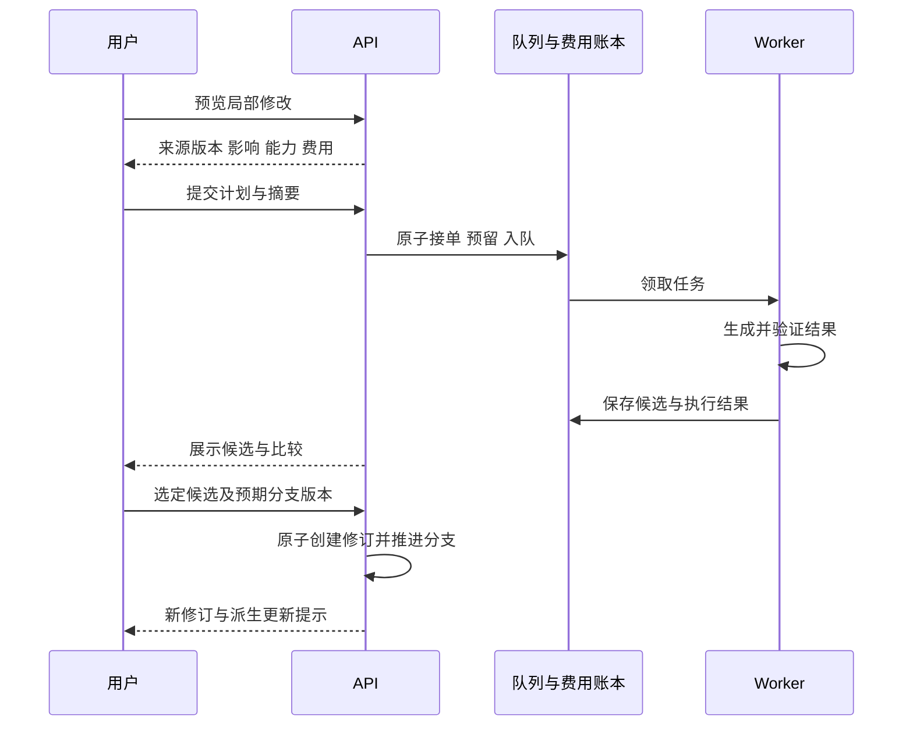

# 首期：资产复用、局部修改与多规格交付

日期：2026-10-28；实施记录更新于 2026-10-29。状态：实施中，资产库首批已接入。本文细化[总体方案](2026-10-28-creative-production-design.md)的 P0；未交付部分仍为目标设计，当前接口事实源是 [OpenAPI](../../../api/openapi.json)，实际交付边界见第 10 节。

## 1. 范围与默认值

首期覆盖角色／商品／场景资产卡、版本化引用、候选比较与选定、图片遮罩编辑、等时长单镜头替换、创作分支与恢复、影响与费用预览、横竖方视频及封面派生、基础导出检查。

首期不提供自动分支合并、视频内部物体的时序局部编辑、声音克隆、自动主体跟踪、自动发布。目录和实体预留后续边界，但不创建没有用途的空实现。

默认保留现有媒体容量、清晰度和时长限制。每计划最多 16 个节点、每候选组最多 4 个结果；首期每项目最多 20 个活动分支、20 个活动派生版本。归档不解除历史文件占用。分页默认 20、最大 100 项。总存储继续计入现有组织／项目配额。

## 2. 基础模型与引用语义

### 2.1 资产库

LibraryAsset 保存空间、类型、名称、当前版本和归档状态；AssetVersion 保存结构化卡片、参考文件、禁止变化项、来源与摘要。角色／商品／场景采用类型化 payload，不能依赖任意 JSON 键解释业务规则。

资产版本参考文件记录 `blob_id, content_sha256, mime_type, width, height, role, view_angle, source_ref`。`source_ref` 是追溯信息，读取文件不能继续依赖原项目的存活。将项目素材提升到资产库时验证归属、复制到资产库受控不可变对象，并在对象就绪后提交版本记录。首期可以实际复制文件，不跨租户去重。

项目绑定使用 `library_asset_id + asset_version_id + usage`。消费时验证同空间与当前权限。归档阻止新绑定，不删除历史；授权撤销是独立状态，新执行必须重新检查。跨项目复用仅限同空间显式绑定，不放宽现有任意项目素材 ID 的读取限制。

为了复用当前媒体校验与生成接口，绑定参考时创建项目本地 MediaAsset 投影，带新增来源映射；现有 `reference_asset_id` 仍指向本项目资产。新多参考生成由引用解析器读取固定版本，然后编译为供应商支持的请求。旧单参考与新引用字段同时出现且不一致时拒绝，不猜测优先级。

### 2.2 完整创作修订

ProjectRevision 保存不可变清单：项目简报、剧本快照、分镜快照、媒体时间轴、海报、项目资产引用、库资产绑定和父修订。文件仍在 BlobStore；快照只保存摘要与受控标识。

不纳入可恢复创作状态的内容包括：费用账本、执行状态、授权与撤销、成员权限、社交回执。历史任务和导出仅作为关联记录展示。恢复会创建新修订并推进目标分支，不能重启旧任务或重新发布。

ProjectBranch 保存 `head_revision_id` 和 `version`。初始只有 `main`，旧项目接口固定操作 main。扩展后的旧保存流程也必须产生完整修订，确保通过旧编辑入口修改的内容不绕过新版本体系。其他分支只能通过新接口读写，不能让旧接口隐式切换活动分支。

### 2.3 变化与影响

DependencyEdge 从消费者修订指向其明确来源版本，包含引用用途和可选镜头／时间范围。影响查询返回四种分类：

| 分类 | 含义 | 首期行为 |
| --- | --- | --- |
| changed | 用户明确要求修改的对象 | 生成新候选或编辑修订 |
| revalidate | 需重新检查但可继续复用 | 例如画幅变化后的字幕位置 |
| optional_update | 已派生版本可能需要升级 | 提示来源变化，保持原版本 |
| unchanged | 引用与设置不变 | 不重新生成 |

影响预览不等于模型能可靠判断视觉效果。替换镜头保持时长时仍需提示相邻转场和接缝需要复查，但不自动重做相邻镜头。

## 3. 操作计划与执行状态

### 3.1 两阶段操作

第一阶段创建 ChangePlan，输入目标分支、预期头修订与版本、操作内容和模型选择。服务端完成授权、依赖分析、能力编译和费用预览，返回有期限的计划；创建计划本身不触发收费模型调用。规则分析无法得出费用时返回 `needs_quote`，不能提交执行。

计划摘要覆盖规范化输入、来源修订、媒体摘要、模型配置版本、有效参数、能力合同版本、币种、各子任务上限和计划总上限。计划默认 15 分钟有效，实际截止时间取报价有效期与计划有效期的较早值。

第二阶段提交计划，服务端重新验证头修订、权限、授权、模型和价格版本。提交请求只包含计划标识、摘要与费用确认，不能在提交时夹带变更。接单时保存 OperationRun、预留费用、写入队列与幂等回执。没有任何费用依据的远端任务不可接单。

各收费节点分别使用现有账本条目预留，计划总额只作同币种汇总与上限校验，不再重复预留一次总额。接单对本 run 已确定的全部收费节点做原子预留；后续未开始节点因取消而释放时，必须证明尚未越过 dispatch 边界。新计划不能借用旧 run 的未知预留继续执行。

有前序依赖的收费节点若其准确输入无法预先报价，不在本次 run 隐式执行。首期将其拆成后续计划，例如生成完成后另行预览两图比较；原计划显示“比较未包含”，避免低估费用。

### 3.2 状态与恢复

计划状态：`ready / needs_quote / expired / consumed`；历史计划不可修改，新编辑生成新计划。

执行状态：`queued / running / awaiting_selection / succeeded / failed / canceled / unknown`。节点状态沿用现有队列语义，run 状态只是节点和选择结果的汇总，不创造第二套队列。

只有需要采用新素材的生成操作进入 awaiting_selection。比较操作保存报告后成功；绑定和恢复属于用户在计划中已确认的本地变更，worker 提交修订前再次校验分支版本，通过后直接成功，冲突则失败并保留计划记录。所有操作都不能因后台执行晚于用户编辑而跳过最终版本检查。

- 部分候选失败时保存成功候选与失败原因，允许用户选择成功结果。
- 远端已发送但结果不明时置 unknown，保存上游 ID 和费用占用；恢复查询只查询原任务。
- 取消阻止未开始节点继续执行，不保证终止已发出的上游计算。晚到结果记录在原任务中，不自动应用。
- 选择成功候选时，run 可完成创作选择，但其他节点的 unknown 费用仍保留；前端分别显示创作状态与费用状态。
- 新一次收费尝试通过新计划提交，不因更换幂等键自动消除旧结果不确定性。

### 3.3 候选选定

候选保存输入修订、操作、输出素材、模型配置版本和校验报告。生成结束只入库，绝不自动推进分支。

选定时携带目标分支最新预期版本。如果分支发生变化，返回 409，候选仍保留。用户可重新预览应用到最新修订，或从候选的基础修订创建分支。服务端重新检查素材可用性、权限与授权，再以一次事务保存新修订、依赖边、选择记录和分支头。



## 4. 局部修改与版本恢复

图片编辑输入包含原图版本、mask、允许变化范围和编辑描述。mask 必须与原图坐标一致。服务端规范化方向和尺寸后保存编辑输入，避免前端显示坐标与模型输入坐标不同。前后对比支持并排和滑杆，保留原图、模型原始输出与最终合成结果的来源关系。

首期视频替换仅替换镜头画面。原镜头自带声音需显式选择保留原声音、使用新声音或静音；默认不自动采用模型生成的新声音。保留原声音时先把原片段音频作为独立引用，不能因替换画面 AssetID 而意外丢失声音。独立配音、字幕、镜头 ID、时槽、转场参数和其他轨道引用不变。

新片段不足时长时拒绝应用；超出时长时显示裁切区间并由用户选定。最终时长按当前帧率时间基准校验，容差不超过一帧；音频边界另检查截断和同步。转场重叠以现有时间轴计算规则为准。

恢复使用旧修订清单生成新修订，保留执行与选择历史。项目缺失文件时返回明确缺失列表，不恢复出看似成功但不可读取的版本。恢复是本地版本操作，不产生模型费用。

## 5. 多规格交付与质量检查

DeliveryVariant 保存 `source_revision_id, version, kind, aspect_ratio, resolution, clip_selection, crop_overrides, subtitle_overrides, cover_selection`。初期 `kind=video/cover`。视频支持从来源选择有序镜头／区间，改变长度仍需验证字幕、音频和转场；首期不自动生成新开场和文案。

静态裁切可逐镜设置焦点或矩形区域；若裁切遮挡主体，用户选择手工调整或完整画面留边。封面默认从来源画面指定帧提取，可以使用现有文字／Logo 图层。新增生成封面需单独计划，不能在导出动作里隐藏收费。

检查流程：

1. 静态检查素材存在、范围合法、字幕矩形、安全区、字体可用性、分辨率和长度。
2. 渲染绑定不可变的派生版本、修订与完整输入摘要。
3. 对实际文件检查可解码性、时长、尺寸、字幕实际布局、黑帧与音轨静音区间。
4. 用户确认警告，记录发现 ID、输入摘要、操作者与时间；后续修改使原确认失效。

`error` 是不能交付的缺失素材、解码失败等确定性错误；`warning` 是可能有意使用的黑场、静音等；`info` 是普通提示。没有执行的检查记录为 `not_run`，不冒充通过。文字纠错首期只包含可确定的缺字／渲染问题，语义检查后续作为可选收费任务。

交付清单列出各文件及各自检查状态。存在 warning 时可以预览并经用户确认下载；有 error 的版本不能标为 ready。发布中心只接收用户明确选择且经过相应确认的文件，不自动发送。

## 6. API 目标合同

### 6.1 通用约定

沿用 `/api/v1`、`space_id` 查询参数、会话认证、编辑者权限、CSRF 与 Origin 检查。空间由服务端授权解析，客户端提交空间标识不授予权限。跨空间对象返回 404；同空间角色不足返回 403。

变更接口使用 `Idempotency-Key`，沿用现有 8–128 位允许字符规则。新接口回执按空间、操作族和键唯一，相同键不同规范化 body 返回 409；相同 body 返回原结果。同键重放仍先验证当前访问权，不因回执绕过撤销或租户隔离。

并发字段显式区分 `expected_branch_version`、`expected_head_revision_id`、`expected_asset_version_id` 和 `expected_variant_version`；不把项目版本与媒体版本混为一个整数。版本冲突不自动覆盖草稿。

列表使用稳定排序和不透明 `cursor`，返回 `{items,next_cursor}`；游标绑定空间、过滤条件与排序。新不可变内容响应携带 `content_sha256`。上传沿用现有受控媒体上传，再显式提升为资产版本；不引入任意 URL 抓取接口。

### 6.2 路由与效果

表内路径省略 `/api/v1`；`{id}` 为项目 ID。

| 方法与路径 | 输入重点 | 返回／副作用 |
| --- | --- | --- |
| `GET /library/assets` | kind、状态、cursor | 200，同空间资产摘要 |
| `POST /library/assets` | 类型、名称、首版卡片与来源素材引用 | 201，身份和首版本；本地复制文件 |
| `GET /library/assets/{assetId}` | 空间 | 200，身份及版本摘要 |
| `GET /library/assets/{assetId}/versions` | cursor | 200，分页版本 |
| `GET /library/assets/{assetId}/versions/{versionId}` | 空间 | 200，完整不可变版本 |
| `POST /library/assets/{assetId}/versions` | 预期头版本、新卡片与参考 | 201，新版本；旧绑定不变 |
| `POST /library/assets/{assetId}/archive` | 预期头版本 | 200，阻止新绑定，不删除历史 |
| `GET /projects/{id}/branches` | cursor | 200，分支摘要 |
| `POST /projects/{id}/branches` | 名称、基础修订 | 201，新分支 |
| `GET /projects/{id}/revisions` | branch_id、cursor | 200，修订摘要 |
| `GET /projects/{id}/revisions/{revisionId}` | 空间 | 200，完整修订 |
| `POST /projects/{id}/change-plans` | 基础分支、操作、模型选择 | 201，影响、能力与报价；不执行模型 |
| `GET /projects/{id}/change-plans/{planId}` | 空间 | 200，固定计划与有效状态 |
| `POST /projects/{id}/change-plans/{planId}/commit` | 摘要、预期分支、费用确认 | 202，run；纯本地操作也经 run 统一记录 |
| `GET /projects/{id}/operation-runs/{runId}` | 空间 | 200，节点状态、候选及费用状态 |
| `POST /projects/{id}/operation-runs/{runId}/cancel` | 原请求键与 run 标识 | 200，停止待执行节点 |
| `POST /projects/{id}/operation-runs/{runId}/resume` | 原 run 标识、明确查询意图 | 202，仅恢复已有上游任务查询 |
| `POST /projects/{id}/candidate-selections` | 候选、目标分支、预期头与版本 | 201，选择记录与新修订；不重新生成 |
| `GET /projects/{id}/variants` | cursor | 200，派生版本摘要 |
| `GET /projects/{id}/variants/{variantId}` | 空间 | 200，派生设置与版本 |
| `POST /projects/{id}/variants` | 固定来源修订、规格与覆盖项 | 201，派生版本 |
| `PUT /projects/{id}/variants/{variantId}` | 预期版本、完整派生设置 | 200，新版本；旧导出和检查保留但过期 |
| `POST /projects/{id}/variants/{variantId}/checks` | 预期版本 | 202，静态检查任务 |
| `POST /projects/{id}/variants/{variantId}/exports` | 预期版本、静态检查 ID | 202，渲染及文件检查任务 |
| `GET /projects/{id}/delivery-jobs/{jobId}` | 空间 | 200，检查／导出状态与报告 ID |
| `GET /projects/{id}/quality-reports/{reportId}` | 空间 | 200，发现与确认记录 |
| `POST /projects/{id}/quality-reports/{reportId}/acknowledgements` | 发现 ID、输入摘要 | 201，用户确认记录 |
| `GET /projects/{id}/delivery-jobs/{jobId}/file` | 文件访问权与交付状态 | 200，受控下载；不暴露私有对象键 |

绑定资产、修订恢复和图片／视频修改都通过 `change-plans` 的有限操作类型表达。首期支持 `bind_reference / edit_image / replace_clip / restore_revision / compare_candidates`。这些名称不是任意可扩展脚本语言，每类有独立 schema 与输入限制。

纯本地计划可以没有费用项；上传与手工修改不假装调用模型。`compare_candidates` 必须确定两张候选后才能报价。现有单任务 `runtime-quote` 与创作接口仍保留，新计划内部复用其报价和执行治理，不从 HTTP 层递归调用自己。

### 6.3 请求与响应示意

以下 ID 和金额只用于展示目标合同，不是可执行请求或真实报价。`model_config_id`、配置版本和预算字段沿用现有治理含义；预览服务产生的摘要才可以提交。

```json
{
  "branch_id": "branch_main",
  "expected_branch_version": 7,
  "expected_head_revision_id": "revision_7",
  "operation": {
    "type": "edit_image",
    "shot_id": "shot_2",
    "source_asset_id": "image_original",
    "mask_asset_id": "mask_background",
    "prompt": "将选定区域改为阴天街道背景",
    "preserve_outside_mask": true,
    "candidate_count": 2
  },
  "model_config_id": "model_config_example",
  "model_config_version": 3
}
```

计划响应至少包括 `id, status, base_revision_id, expected_branch_version, normalized_operation, effective_controls, impacts, nodes, budgets, expires_at, plan_sha256`。每个费用项带节点 ID、币种、预计金额或明确未知、可信最大预留额、来源及过期时间；无可信上限时状态不能为 ready。

```json
{
  "plan_sha256": "aaaaaaaaaaaaaaaaaaaaaaaaaaaaaaaaaaaaaaaaaaaaaaaaaaaaaaaaaaaaaaaa",
  "expected_branch_version": 7,
  "expected_head_revision_id": "revision_7",
  "confirmed_budgets": [{"currency": "CNY", "maximum_minor": 200}]
}
```

提交成功返回 `202 {"run_id":"run_example","status":"queued","plan_id":"plan_example"}`。客户端通过明确的 run GET 查询；网络中断时用原 body 和原键重放，不能另建一次收费任务。

错误沿用 `{error:{code,message}}`，新接口增加可选 `error.details`，仅包含有权限的版本、字段和可恢复操作信息。例：

```json
{
  "error": {
    "code": "branch_version_conflict",
    "message": "当前分支已更新，请保留编辑并重新预览应用范围",
    "details": {"current_branch_version": 8, "current_revision_id": "revision_8"}
  }
}
```

错误分类：400 输入或不支持的控制组合；401 未登录；403 权限／授权不足；404 不可见资源；409 幂等冲突、版本冲突、计划过期、模型变更、预算不足；413 容量上限；415 媒体格式；429 并发／速率限制；503 必需执行能力未就绪。可通过刷新解决的冲突返回具体 code，不能将所有 409 自动重试。

## 7. 存储实现与迁移

### 7.1 PostgreSQL

拟新增 `studio_library_assets`、`studio_library_asset_versions`、`studio_project_revisions`、`studio_project_branches`、`studio_dependency_edges`、`studio_change_plans`、`studio_operation_runs`、`studio_candidate_sets`、`studio_selections`、`studio_delivery_variants`、`studio_quality_reports` 及新域幂等回执表。

主键与所有外键包含 `space_id`；常用索引包括项目修订时间、分支头、资产版本、来源反向依赖和 run 状态。列表字段使用明确列，类型化 payload 可保存在 JSONB；不能把全空间对象打包回一个 scope。新表映射进入备份／恢复与迁移工具。

预算继续使用现有账本，任务继续使用 `execution_jobs`。显式事务协调器传入同一 SQL 事务，完成以下边界：

1. 接单：验证计划 → 建 run／回执 → 预留子任务费用 → 入队 → 提交。
2. 生成完成：确认租约 → 验证已落盘对象 → 保存候选与节点结果 → 提交。
3. 用户选定：比较分支版本 → 新修订／引用边 → 选择记录 → 更新头与 main 兼容投影 → 提交。

数据库事务不能覆盖外部模型调用或编码过程。费用实际结算仍由可信证据驱动，不把节点成功等同于准确扣费。

### 7.2 文件模式

现有多个领域 JSON 快照不能通过连续 rename 达成跨域事务。首期引入提交根清单：每次跨域变更将所有受影响域的新快照写入带事务 ID 的不可变文件，完成写入与同步后原子替换唯一根清单。清单包含域快照路径、摘要和格式版本；重启只读取根清单引用的完整提交。

必须适配新创作域、旧项目／媒体状态以及本地接单所需的创作任务／预算快照，不能只原子写入新增表。未引用快照与暂存对象在恢复检查后延迟清理。现有内存队列从已提交任务记录恢复；单写者锁保持。

若根清单格式已启用，旧程序不得继续写入旧快照。上线前迁移备份覆盖全部 DATA_DIR；回滚恢复匹配版本完整备份。该机制只承诺仓库支持的运行文件系统上的已测试原子替换，必须通过 Linux 实际崩溃恢复测试。

### 7.3 迁移步骤

1. 停止写入和 worker 接单，备份数据库、文件、对象引用清单与独立密钥；核对活动／unknown 任务，保留原恢复语义。
2. 创建新结构，为每项目建立 main 与初始完整修订，为现有文件计算摘要；记录可重复执行的迁移映射与检查点。
3. 旧角色字符串只迁移为候选来源元数据，不根据同名自动合并为同一个人；库资产由用户显式建立或确认提升。
4. 更新旧保存入口为事务内追加修订并更新 main 投影；文件模式启用根清单。活动任务完成后只能入库候选或保持原有已声明行为，不盲目重发。
5. 校验项目数、素材数、摘要、版本、预算和队列状态；演练备份恢复与受控文件读取。
6. 全部 API／worker 更新到相同格式支持版本后，开启 P0 功能；不允许旧新写入进程混跑。

迁移只产生本地元数据和摘要，不调用模型。迁移失败保持停写，按检查点修复或恢复备份，不能静默回退空库。

## 8. 文件级实施工作包

以下为实施落点与交付依赖，所有新文件名均为建议；应按职责拆分，避免把功能继续集中到现有大文件。

| 工作包 | 主要落点 | 完成条件 |
| --- | --- | --- |
| P0-01 引用与修订纯规则 | 新 `modules/library`、`modules/revisions`；架构测试 | 固定版本、变化分类、分支恢复规则通过 |
| P0-02 显式事务与迁移 | 新领域仓库／事务协调；现有 postgres、backup、project_store、media_store | 两种存储原子性、兼容保存、恢复演练通过 |
| P0-03 资产库纵向功能 | library HTTP／仓库；新 `features/library`、页面与路由；OpenAPI | 建卡、版本、项目绑定、权限及引用可用 |
| P0-04 能力编译与计划 | governance 能力类型；runtime catalog／quote；plan 用例 | 不支持组合拒绝，计划摘要与费用一致 |
| P0-05 候选执行与选择 | creative job adapter；新 run／selection 协作；worker 装配 | 接单幂等、未知恢复、选定冲突与部分成功 |
| P0-06 局部编辑界面 | 现有遮罩、CreativeTools、ProjectMedia；新对比组件 | 原图保留、等时长替换、原音处理、回退 |
| P0-07 派生交付与检查 | 新 `modules/delivery`；media render；`features/delivery` | 横竖方、封面、检查报告和受控下载 |
| P0-08 全流程与部署 | 合同、E2E、媒体、数据库恢复测试；部署与备份文档 | 固定验收故事和升级恢复通过 |

顺序：01 → 02 → 03；04 可在 01 的模型稳定后开展；05 依赖 02、03、04；06 依赖 05；07 依赖 02、03 并复用 04 的任务边界；08 汇总验收。每个工作包应是可独立评审和回滚到兼容数据版本的变更集合。

前端保持现有 React／TypeScript 和路由结构，不引入新状态框架。库资产、分支、候选与派生的缓存键必须包含空间和版本；相同项目切换分支也要触发未保存草稿保护。每个新增用户流程同时提供中英文文案、键盘可达操作与移动布局。

## 9. 验收用例

| 编号 | 操作／故障 | 必须观察到的结果 |
| --- | --- | --- |
| A01 | 资产 v1 绑定两个项目后创建 v2 | 两项目仍固定 v1；显式更新才改变 |
| A02 | 跨空间引用库资产／候选／导出文件 | 404，不泄露名字、摘要或文件 |
| A03 | 删除来源项目或归档资产 | 已复制的受控库版本仍可追溯；归档阻止新绑定 |
| A04 | 同键同输入重放／同键不同输入 | 前者返回原记录，后者 409，无重复费用预留 |
| A05 | 计划生成后改分支、模型或价格版本 | 提交拒绝并要求重新预览，不执行旧计划 |
| A06 | 外部调用后 worker 崩溃 | 原任务 unknown，不重复生成，预留未被误释放 |
| A07 | 两个候选成功、两个失败 | 成功候选可选择，失败与费用单独显示 |
| A08 | 生成期间编辑时间轴，随后选定候选 | 409，当前编辑不被覆盖，候选仍可用 |
| A09 | 图片保护区局部修改 | 允许区域外合成像素一致，羽化带范围明确 |
| A10 | 第 2 镜等时长换画面且保留原音 | 其他镜头、字幕、独立音轨引用不变；原音正确提取并复用 |
| A11 | 恢复旧修订 | 新建修订，无模型请求；费用、撤销、发布记录不回退 |
| A12 | 主版本更新后查看旧派生 | 原成品可复现，显示更新提示而不自动修改 |
| A13 | 修改派生字幕后使用旧检查确认导出 | 旧报告摘要失效，必须重新检查 |
| A14 | 含黑场／静音的导出 | 返回具体区间与警告，可人工确认，不直接宣称错误 |
| A15 | 缺失字体或文件 | 明确 error，不替换字体或输出空白后标记成功 |
| A16 | 文件根清单切换前后崩溃 | 恢复到完整旧提交或完整新提交，不出现混合域状态 |
| A17 | PostgreSQL 接单／选定事务中断 | 费用、任务、分支与回执满足各自原子边界 |
| A18 | 备份恢复与旧项目编辑 | 素材引用完整，main 与兼容接口一致，unknown 任务未重发 |
| A19 | 页面刷新、切空间、切分支、返回上一步 | 草稿保护与未知请求核对有效，无空间缓存串用 |
| A20 | 三镜项目完整故事 | 建卡 → 生成／上传 → 选定 → 局部修改 → 回退 → 四类导出完成 |

执行现有相关 Go 测试、前端类型／lint／单元／构建、OpenAPI 合同、实际媒体、浏览器及 PostgreSQL 恢复检查。只写纯规则和真实风险测试，不用固定假返回值证明模型效果。运行依赖外部服务的适配器时采用明确模拟服务；真实模型验收单独记录，不能与离线合同测试混计。

设计阶段的文档验证仅检查内容、链接、示例格式与差异。实施证据见下节；没有列为通过的验收目标仍未完成。

## 10. 实施记录（2026-10-29）

当前已接入第一批「资产库与项目引用」。完整 P0 仍在实施，七类产品能力没有全部交付。

| 工作包 | 当前状态 | 实际边界 |
| --- | --- | --- |
| P0-01 | 部分完成 | library 规则及 revisions 分支 CAS、摘要、依赖环规则已有测试；完整修订尚未接入存储和界面 |
| P0-02 | 部分完成 | 资产库文件快照、独立 PostgreSQL 表、导入导出及对象清单已接入；跨领域提交根清单尚未实现 |
| P0-03 | 首批已接入 | 三类资产卡、参考图、不可变版本、归档、列表分页、项目版本绑定、中英文及移动端 |
| P0-04～P0-07 | 待实现 | ChangePlan、候选执行与选定、完整修订恢复、受保护局部修改、派生成品和导出检查 |
| P0-08 | 部分完成 | 下列已有功能的回归通过；完整 A20 故事未达到验收条件 |

入口是 `/library` 和 `/projects/:projectId/references`。资产卡包含类型化描述、禁止变化项及最多 12 张 PNG/JPEG 参考图；单张最多 4 MiB。创建版本时复制来源项目图片到独立库对象，随后可以直接保留该库引用，不再依赖原项目图片。版本列表按版本号倒序分页。

项目绑定保留具体 `asset_version_id`，并复制参考图到项目本地媒体；库资产更新不会改变已有绑定。现阶段通过 `POST /projects/{id}/library-bindings` 直接完成不收费的媒体变更，绑定与项目参考素材在同一次媒体状态提交中保存；尚未经过设计中的 ChangePlan 和完整项目修订。回执重放返回当前媒体视图，不会重复创建绑定。角色描述、禁止变化项不会被隐式注入所有生成请求；用户仍需在已有创作工具里选择复制后的参考图片。声音描述不是声音模型绑定或复刻。

保存与绑定在提交前保留原请求体和幂等键，网络结果不明时锁定输入并允许核对，页面刷新后可以恢复该核对。已归档资产保留历史，但不能新增版本或新绑定。未引用的预写入文件暂时保留并计入物理媒体配额，没有新增自动清理任务；后续清理必须先证明它们没有被已提交版本引用。

验证证据：

- Go：所有领域模块、架构边界及资产库文件存储测试通过；新增模块 `go vet` 通过。
- Linux 实际执行：资产版本与幂等、参考图独立保存及项目固定版本绑定、真实鉴权／CSRF／只读角色／跨空间隔离测试通过。
- 临时 PostgreSQL 16：并发 CAS、原始回执、迁移事务回滚、归档历史和导出到文件模式后读取测试通过；每次测试使用独立 schema。
- OpenAPI 结构校验通过；真实服务 HTTP 合同检查通过（本次 449 个响应，包含轮询），新增资产接口、项目绑定和重启回执纳入该脚本。
- 前端：类型检查、lint、40 项单元测试、构建及 1244 条文案静态覆盖通过。
- 浏览器：最终桌面／手机完整路由回归 24 项通过，包含新增 8 项资产流程。一次完整运行中恢复用例出现过偶发失败，随后单独重复 6 次及最终完整回归均通过，尚未确认该偶发失败的根因；未以放宽断言消除失败。
- 浏览器使用明确的 HTTP 模拟服务，后端测试使用真实代码与临时数据库。没有调用收费模型，因此这些测试不证明锁脸、商品细节或模型生成质量。

运行时环境说明：最初 Windows 无法执行 Linux 专用后端，且 Docker 引擎不可用；随后恢复 Docker Desktop，并通过 WSL 执行 Linux 测试与临时容器运行真实 HTTP 合同。过程中沙箱执行账户出现错误 1909，后续检查通过正常执行环境完成。不能把最初的交叉编译当作实际运行证据；上列 Linux 和 PostgreSQL 结果来自后续实际运行。
