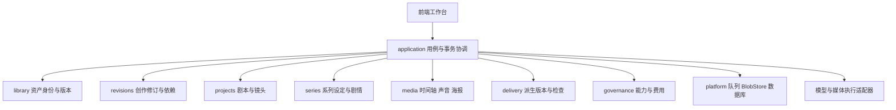

# 可控创作与多平台生产总体方案

日期：2026-10-28。状态：设计提案；新增模块、接口、配置与验收目标均为拟实现内容，不代表已上线。

本方案将角色／商品／场景一致性、局部修改、AI 导演、系列短剧、品牌设计、声音多语言、多平台交付纳入当前项目。用户已认可前轮架构方向；本文把该方向细化为可分期交付的工程设计。第一期详细合同见[首期设计](2026-10-28-controlled-creation-phase1-design.md)。

## 1. 目标与基本决策

目标是让用户复用已确认的创作资产、只修改需要变化的部分，并从一个项目持续产出多个成品版本。核心交付单位从一次生成任务扩展为有来源、有选定记录、可恢复的创作版本。

采用现有模块化单体、独立 worker、PostgreSQL 队列与 BlobStore。增加业务模块和显式事务边界，不引入新的微服务、消息队列、图数据库或通用工作流产品。依赖关系先用关系表表示；检索先采用结构化筛选，是否增加向量索引由真实规模与检索评估决定。

三个备选方向的取舍：

| 方向 | 收益 | 代价 | 决策 |
| --- | --- | --- | --- |
| 在现有工具表单直接加参数 | 单点交付快 | 历史、跨项目复用、费用和派生关系容易各自实现 | 只用于已有模块内部的小扩展 |
| 增加版本化资产、创作修订与受控操作计划 | 七类功能共享基础，允许逐期上线 | 需要首先补齐存储与事务合同 | 采用 |
| 重建为微服务和通用流程引擎 | 可独立扩容与编排 | 当前阶段迁移和运维成本高，分布式一致性更复杂 | 暂不采用 |

模型生成效果与软件行为分开验收。选定引用、版本回退、未修改素材复用可以确定性验证；锁脸、服装细节、商品几何、动作和口型必须用真实模型样片评估。模型不可用时，仍可上传素材、编辑、排版和导出。

## 2. 当前基础与改造依据

| 当前实现 | 可复用部分 | 需要改变的部分 |
| --- | --- | --- |
| [项目与剧本](../../../backend/internal/modules/projects/script.go) | 剧本、历史、版本校验 | 当前强制 2 个角色、3 个场景；角色缺稳定 ID |
| [分镜](../../../backend/internal/modules/projects/storyboard.go) | 镜头 ID、景别、运镜、时长 | 场景序号关联、结构化控制项不足 |
| [创作任务](../../../backend/internal/application/provider_creative_store.go) | 参考、遮罩、比较、语音、视频任务 | 单参考字段、结果选定、资产版本和依赖计划不足 |
| [媒体模型](../../../backend/internal/modules/media/model.go) | 素材、镜头、音轨、导出快照 | 全项目修订、分支、多海报、多语言及派生版本不足 |
| [媒体保存](../../../backend/internal/application/media_store.go) | 版本冲突与幂等 | 新领域和旧状态之间需要显式事务，不能增加多份非原子写入 |
| [执行治理](../../execution-governance.md) | 请求报价、预算预留、未知费用 | 增加整条操作计划的子任务汇总与上限控制 |
| [队列](../../../backend/internal/platform/jobqueue/queue.go) | 持久队列、租约、结果未知恢复 | 新任务类型、有限依赖执行和不同资源任务的调度 |
| [架构](../../architecture.md) | 模块边界、API／worker 共享装配 | 避免继续扩大 scope 整体读取与全局锁 |
| [前端路由](../../../frontend/src/App.tsx) | 会话、空间、懒加载、草稿保护 | 增加资产库、版本、交付等工作页 |

当前媒体上限继续生效：最多 30 镜、8 条附加音轨、4 个画面叠层；输出分辨率对应的时长限制不随本方案自动提高。系列可以包含多集，每集单独导出。突破容量上限需要独立性能评估。

## 3. 业务模块与依赖

新增目录为实施目标，不要求先创建空目录：

| 目录 | 责任 | 不负责 |
| --- | --- | --- |
| `backend/internal/modules/library` | 角色、商品、场景、品牌、声音档案及不可变版本 | 模型调用和文件下载 |
| `backend/internal/modules/revisions` | 修订清单、分支、引用边、变化集、影响分类 | 自动重生成下游 |
| `backend/internal/modules/delivery` | 多规格派生、裁切计划、检查结果与确认 | 直接社交发布 |
| `backend/internal/modules/series` | 集、设定、事件、关系、伏笔、检查建议 | 擅自改写正式设定 |
| 现有 `projects` | 剧本、镜头、导演控制要求 | 外部模型能力判断 |
| 现有 `media` | 图像编辑参数、时间轴、海报、音频段及渲染规则 | 存储与供应商 SDK |
| `application` 的领域文件组 | 授权、仓库端口、操作计划、接单、选定、导出协作 | 无界通用流程编排 |

新模块以稳定 ID 和版本号交换引用，由应用层协调，默认不相互导入。若需要共享值类型，单独审查并更新现有架构依赖测试；不绕过测试放开全部模块互相引用。基础设施仍不能反向引用业务模块。

## 4. 核心数据模型

| 实体 | 关键内容 | 不变量 |
| --- | --- | --- |
| LibraryAsset | `id, space_id, kind, name, head_version_id, status` | 身份稳定；类型不能任意转换 |
| AssetVersion | 结构化属性、参考文件、来源、内容摘要、创建人 | 已保存版本不可变 |
| AssetBinding | 项目、资产身份、明确版本、用途 | 不保存隐式的“始终用最新版” |
| ProjectRevision | 父修订、剧本／分镜／媒体快照、资产引用、摘要 | 完整可恢复；只追加 |
| ProjectBranch | 项目、名称、头修订、并发版本号 | 推进头指针须比较并交换 |
| DependencyEdge | 消费者修订、来源修订、用途、镜头／时间范围 | 指向明确版本；禁止依赖环 |
| CandidateSet | 目标镜头／素材、来源修订、候选、比较结果 | 模型完成不等于用户选定 |
| Selection | 候选 ID、选定人、时间、目标分支和新修订 | 保留选择历史 |
| ChangePlan | 基础修订、变更、影响、子任务、费用、过期时间、摘要 | 提交后输入不可变 |
| DeliveryVariant | 来源修订、画幅、语言、时长、布局、覆盖项 | 来源更新后只提示，不静默跟随 |
| QualityReport | 检查器版本、输入摘要、时间点／区域、严重度、确认记录 | 修改输入后旧确认失效 |

### 4.1 资产类型

- 角色：外观特征、多角度参考、发型、造型版本、表情参考、禁止变化项、声音档案引用。人物身份与单场造型分开。
- 商品：型号、实际规格、材质、尺寸比例、包装、多视角、Logo 和准确文字。严格商品展示优先复用实拍／三维渲染素材。
- 场景：空间描述、关键物件、相对位置、布局参考、光照状态、可用机位。二维参考不是经过验证的三维空间模型。
- 品牌：字体资源及授权依据、色板、Logo 安全区、模板、商品事实。发布文案与商品事实分别存储。
- 声音：供应商、模型、声音标识、语言、发音词典、授权依据与撤销状态。更换供应商不能自动继承“同一声音”的结论。

参考图保存角度、用途与来源；每次调用由能力检查决定可用数量和组合。用户补充参考不会自动触发收费生成。禁止变化项区分可用合成技术强制保留的内容与仅能提示／检测的内容。

### 4.2 修订与派生

创作历史与执行历史分离。恢复旧修订生成一个新的当前修订，绝不倒退预算账本、任务状态、授权撤销和发布回执。分支首期支持创建、选择、比较、恢复，不提供自动合并。

派生版本以固定主项目修订为基础，保存明确覆盖项。渲染时产出完整清单，绑定模板、字体、裁切路径、音轨、字幕和编码配置。将来更新来源必须显示差异并生成新的派生版本。

## 5. 七类能力的具体实现

### 5.1 一致性与候选选择

建立资产卡 → 绑定镜头 → 生成候选 → 比较 → 用户选定 → 后续镜头复用指定参考版本。

比较结果按面部外观、发型、服装、商品轮廓、标识、空间布局等维度返回发现、证据区域和不确定性，不提供未经校准的“身份准确率”。参考资产和生成候选分别保留，选定候选不会覆盖原始资产卡。

首期单次最多生成 4 个候选，允许逐个成功和选择。每个候选有独立费用项；自动比较也必须是计划中显式列出的任务。候选选择只能改变用户指定的镜头或绑定。

### 5.2 局部编辑与片段替换

图片沿用原图和 PNG mask，记录尺寸、坐标、透明区域语义及 feather 参数。编辑区域以外需要精确保留时，将生成区域与原图合成；输出使用一致尺寸、色彩处理和无损图片格式验证保留区域。羽化带属于允许变化范围。自然修饰、换装等仍需真实效果验收。

视频首期只实现单镜头／已拆分片段的等时长替换。镜头 ID、字幕和独立配音引用保持；新结果时长不足拒绝自动填补，超出时明确选择裁切。用户选定后才更新分支。最终编码允许变化，未修改输入素材引用与解码内容保留程度分别验证。

后续增加时间片段编辑：提取边界上下文帧、时序遮罩、局部任务、接缝检查。模型不支持时明确禁用；不能把“重做整个镜头后裁切”描述为原视频内容的精确局部修改。

改变时长时必须选择保持时槽或顺延，计算字幕、音轨、转场和叠层影响；所有变化进入预览计划。

### 5.3 导演控制与预演

新增 ShotControl：景别、角度、焦段意图、构图、角色站位、动作意图、摄影机运动、首尾帧和草图。每个字段由能力检查返回 `native / reference / prompt_only / unsupported`，组合限制在服务端验证。

第一版动态分镜使用分镜静态图、简单合成运动、现有音频或明确付费的临时配音，输出低分辨率预演。预演确认的是节奏、镜头顺序和对白时长；不等于验证生成视频的人物动作。正式生成只执行用户选定的镜头。

### 5.4 系列短剧

增加 Series、Episode、WorldFact、CharacterRelation、StoryEvent、Foreshadowing 和 StoryFinding。集关联项目，单项目也可以独立存在。事件区分故事发生时间和叙事展示次序；关系与事实有生效范围，能够表达回忆、误认和角色知识差异。

解除固定两角色三场景限制时，同时更新服务端规范化、模型输出合同、OpenAPI、前端编辑器及相关测试。场景从位置序号迁移到稳定 ID，名字只用于显示，删除引用对象需要显式处理依赖。

检查先执行确定性规则，再让模型检查动机、对白和伏笔。每条建议关联证据的集、场景与修订。模型建议不能自动加入正式设定。开场、节奏和结尾方案使用修订分支，比较后由用户选择。

### 5.5 肖像、海报与品牌

肖像提供原图、修饰候选、风格模板、前后对比，复用资产卡和局部编辑。风格一致与主体一致分别配置。

海报采用文本测量、布局约束和主体避让；模型生成文案和布局提案，渲染器负责溢出、对齐、安全区和字体检查。文字与 Logo 保留为独立图层，不要求图像模型准确重画。多尺寸生成独立布局版本；当前单 PosterDocument 作为默认海报兼容投影。

字体以受控资源包形式管理，浏览器预览和服务端渲染绑定同一字体版本；缺字体应报错或让用户明确选择替代。头像系列逐张任务、逐张导出，增加相似候选提示，不强制拼图，不承诺自动消除所有相似主体。

### 5.6 声音表演与多语言

增加 SpeechSegment：句子 ID、角色、语言、文本版本、声音档案、情绪、语速、停顿、发音覆盖和目标时长。现有纯文本语音调用保留兼容，增加支持结构化输入的窄接口；不支持的参数不能静默丢弃。

逐句音频可以单独重做，译稿、字幕、配音、对齐结果分别版本化。音乐闪避根据对白时间生成音量包络，保留人工调整；降噪保留原音与处理后音轨。动作音效根据用户标记或模型建议的事件点定位，事件识别与音效生成分别计费。

跨语言时长处理依次考虑译稿调整、明确范围的语速调整、镜头时长调整，禁止为了匹配长度擅自截断对白。口型任务在选定音频之后执行。声音复刻与口型引擎在本人授权、模型许可、撤销机制、真实样片验收满足后按配置开放。

### 5.7 多平台成品与检查

首期派生横屏、竖屏、方形视频和封面，支持从用户选定的镜头区间形成不同长度版本；复杂节奏重剪后续实现。第二期增加海报和图文卡片组、平台文案及开场变体。

裁切先提供人工焦点和静态裁切，后增加可编辑的跟踪路径。跟踪任务要处理镜头切换、主体消失、多人竞争和安全区，置信不足时保留人工修正入口。扩图属于额外生成操作，不能自动用于裁切失败回退。

检查分为导出前静态检查和导出后文件检查。缺失素材、无效时间、字幕越界、解码失败为确定性问题；黑帧、静音、文字疑似错误为待确认发现。OCR 和语义分析是可选模型任务，不能隐藏费用。无模型时检查器返回未执行，不能显示已通过。

社交发布仍走现有发布中心和明确确认。本流程完成只表示文件可交付，不等于内容已发布。

## 6. 模型能力与执行计划

能力记录拆为配置状态、适配器能力、账号可用性验证、质量验收四层，分别记录证据时间。配置 ready 不等于质量通过。

记录图片多参考数量、mask 语义、首尾帧、视频编辑、角色／商品参考、语音控制、支持语言、时长与分辨率组合限制。编译后的有效参数、未满足要求和降级原因必须在执行前返回。用户确认降级才生成新计划。

不在本文绑定新供应商或报价。实施每个适配器时，核对当时官方合同、账号能力、生命周期和真实样片；沿用项目现有可替换适配器。旧型号可保留历史追溯，但不能作为新任务的隐式默认。

ChangePlan 是有限业务操作列表，不接受用户脚本或任意 DAG。首期单计划最多 16 个节点，限制来源数量和媒体大小。候选比较等需要前序结果的任务在输入确定后获得准确报价；若无法提前给出可信费用上限，计划停在等待用户确认，不能假装已有完整报价。

费用按币种分别汇总，包含候选生成、比较、音频、对齐及其他收费节点。复用现有账本作为唯一扣费依据，不另建第二份余额。未知结果继续占用预留，不能因取消或失败显示为免费；新付费尝试需要新的计划和用户确认。

## 7. 存储、事务与资源控制

新增实体采用显式仓库查询，按空间、项目、资产身份及版本索引；不得通过遍历所有租户状态获取单一资产。依赖边保存反向索引以支持影响查询。初期资产删除仅归档，被历史修订引用的文件不做物理删除。

PostgreSQL 中，修改分支、保存修订、写引用边与幂等回执同事务。执行接单与预算预留、入队同事务。生成和渲染在事务外运行，完成时检查租约与输入摘要；入库候选不推进分支，用户选定时再检查分支版本。

文件模式保留单写者约束。跨域修改采用带原子根清单的完整提交，不能依次写多个 JSON 文件后宣称原子性。具体切换见首期方案。API 和 worker 共用装配、能力及迁移版本。

先将输出上传至临时对象，验证后以受控不可变键写入，最后提交元数据引用。未提交对象作为孤立对象延迟回收；持有租约或历史引用的对象不得回收。BlobStore 不必承诺与数据库跨系统事务。

按任务类别限制生成、渲染、跟踪和本地模型并发，沿用组织配额。1Panel／Compose 部署继续支持；新增功能开关与容量参数只在实际实现时加入部署文件。GPU／模型执行器为可选独立 worker 资源，不进入所有 API 实例镜像。所有新数据表、文件与引用进入备份、恢复和配额检查。

## 8. 页面与接口演进

页面入口保持当前导航和草稿保护。目标入口：

| 页面 | 责任 | 阶段 |
| --- | --- | --- |
| `/library`、`/library/:assetId` | 角色／商品／场景资产及版本 | P0 |
| `/projects/:projectId/references` | 项目绑定与镜头参考 | P0 |
| `/projects/:projectId/versions` | 分支、对比与恢复 | P0 |
| `/projects/:projectId/deliveries` | 派生版本、检查与下载 | P0 |
| 现有 storyboard、media 页面 | 候选对比、编辑计划、选定与镜头控制 | P0／P1 |
| `/series`、`/series/:seriesId` | 系列、集、设定和剧情检查 | P2 |
| 项目品牌／声音工作区 | 品牌布局、多语言对白与音频 | P1 |

扩展现有 `:section` 校验与导航配置，不仅增加菜单。切换空间清理列表缓存、计划和候选选择；缓存键包含空间、项目、分支、修订。结果未知请求保留幂等键及核对入口。中英文 UI 文案与内容语言分别管理。

`api/openapi.json` 继续是运行接口事实源。本文的目标接口在实现对应阶段时进入该文件，并补齐成功、冲突、权限与未知结果示例；本次不把尚不存在的接口写成已支持。

首期接口合同见首期方案。后续按领域增加系列设定／检查、导演预演、海报布局、声音片段、语言版本和跟踪任务资源；均沿用会话、空间授权、CSRF、幂等及错误结构。没有具体适配器实现前，不新增声称支持全部模型参数的通用调用接口。

## 9. 分期交付与依赖

| 阶段 | 工作包 | 交付范围 | 发布门槛 |
| --- | --- | --- | --- |
| P0-A 基础 | 版本与仓库、迁移、资产身份、能力描述 | 现有项目可形成完整修订，资产版本可跨项目显式绑定 | 两种存储恢复、租户隔离、旧接口兼容 |
| P0-B 可控修改 | 候选、比较、图片编辑、单镜替换、计划和费用 | 人工选定后才改变分支，其他内容保持 | 并发编辑／未知结果／回退故障测试 |
| P0-C 交付 | 派生版本、手动裁切、封面、导出检查 | 横竖方成品与封面可追溯到同一修订 | 实际文件检查与完整用户流程 |
| P1-A 导演与品牌 | 动态分镜、镜头控制、品牌套件、约束排版、头像系列 | 低成本预演、多尺寸可编辑设计 | 能力组合检查、布局和字体一致性 |
| P1-B 声音与重构 | 逐句声音、多语言、降噪闪避、主体跟踪 | 每句可替换、各语言独立校对、裁切可修正 | 音画同步、漏字、跟踪失败处理 |
| P2-A 系列 | 稳定角色／场景 ID、系列事实、跨集检查和变体 | 设定可追溯、检查有证据、用户确认入库 | 历史迁移和固定剧情样本验收 |
| P2-B 高阶模型 | 时间片段编辑、复杂动作、声音复刻与口型 | 按已验证模型、场景和授权开放 | 真实效果、许可、成本门槛 |

P1-A 与 P1-B 在 P0 底座稳定后可以分别排期；P2-A 可以提前做数据设计，但不阻塞 P0。P2-B 的各项独立开关、独立验收，不要求同时发布。

排期以工作包和退出条件管理。团队人数、现有线上数据规模、可用模型和验收素材尚未确认，不给出固定周数承诺；P0-A 完成后按实际迁移与测试耗时估算后续周期。

## 10. 验收与上线策略

| 层次 | 必须验证 |
| --- | --- |
| 纯规则 | 引用固定、禁止循环、影响范围、裁切、时长、费用整数与币种 |
| 合同 | OpenAPI 与真实响应一致；幂等冲突、过期计划、权限、字段兼容 |
| 持久化 | 文件原子根切换、PostgreSQL 事务、任务崩溃恢复、备份恢复 |
| 媒体 | 遮罩保留、替换镜头时长、字幕位置、音轨、横竖方输出和封面 |
| 前端 | 草稿保留、版本冲突、跨空间切换、候选选定、移动端操作 |
| 真实模型 | 一致性、局部保留、口型、语音、人工返工次数、接受结果的总成本 |

仓库现有 Go、前端、合同、实际媒体与数据库测试继续使用。当前 Windows 后端工具链限制需在 Linux／容器验证，不能把前端 mock 通过称为完整后端通过。外部适配器运行测试用模拟服务；真实效果验收采用独立授权样片与明确费用上限。

产品确定性门槛包括：未选定候选不修改时间轴；恢复不触发模型；跨租户引用不可访问；同键重放不重复创建；修改源版本不影响已有派生；导出检查绑定最终文件摘要。模型质量门槛在试点前按用例约定，记录成功率、失败类型、P50／P95 耗时及每个接受结果的总费用，不编造统一锁脸分数。

每阶段通过功能开关开放，保留现有工作台入口。迁移先备份并演练恢复，随后停写迁移和更新全部 API／worker。新增功能关闭不等于旧二进制可安全写入；数据回滚需匹配版本备份。

## 11. 首期验收故事

用户建立一位角色和一件商品的资产卡，将指定版本用于 3 个镜头。生成并选定候选后，只修改第 2 镜的背景或替换该镜视频。用户看到修改范围、相关派生版本与费用，选定结果后其他镜头、独立配音和字幕引用保持。用户可以恢复旧版本，再分别导出横屏、竖屏、方形视频与封面，逐项处理检查发现，最终下载文件。

该故事通过后再扩展高阶模型能力。现阶段交付是这套设计文档，代码、迁移与运行接口仍以仓库实际实现为准。
