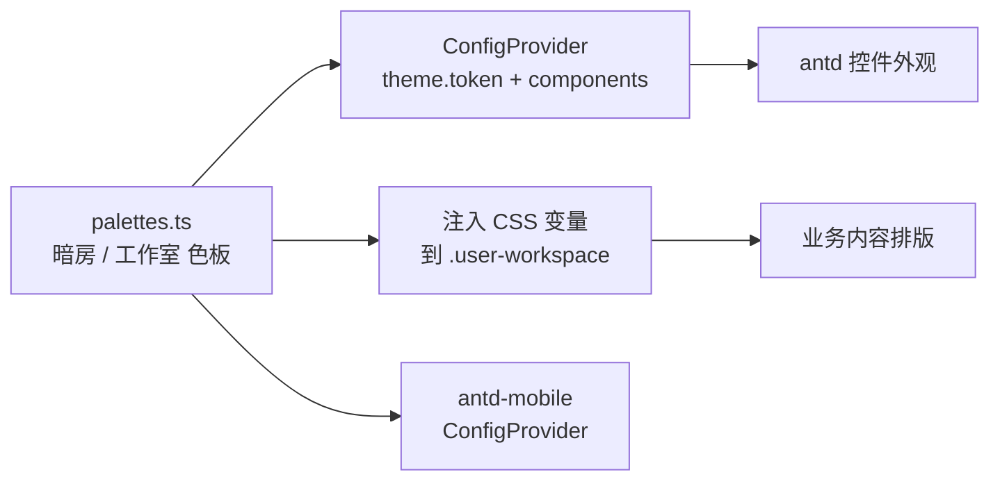
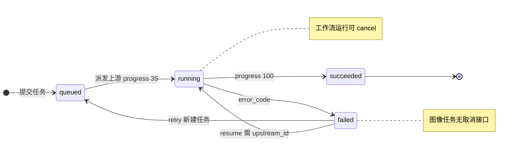
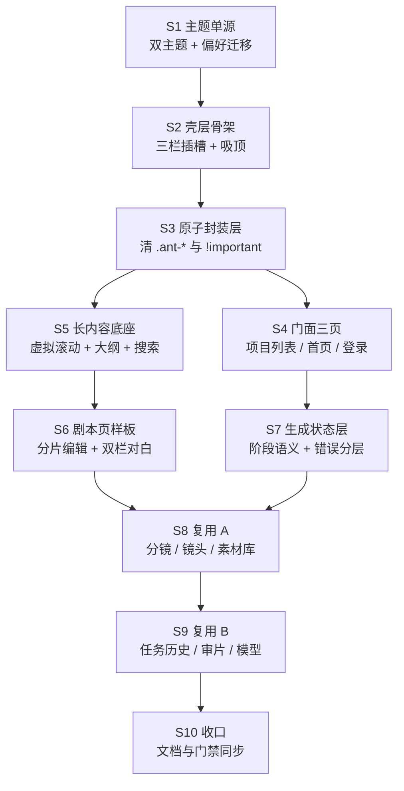

# 改造方案 · 映创工作台 UI 重构与长内容治理

方案对象：`frontend/` 表现层与组件结构  
基线提交：`fce862b9b98fc3cd8ab6d1cecb00d74597599052`  
编制日期：2026-11-19  
状态：**Draft，等待确认后开工**  
前置阅读：同目录 `research.md`（现状诊断）  

---

## 0. 方案摘要

四项定调的落地解释：**深绿深色化**指把品牌深绿从「侧栏专用色」升级为全站主色，画布换成墨绿黑，映窗标记与字体策略不动；**双主题**指新增深色为默认、保留一套沿用现值的亮色，paper 与 screening 下线；**全面 antd 化**指所有通用控件与壳层最终由 antd 承担，画布、时间轴、遮罩、3D、原图查看器按既有规格继续自持；**首批门面三页**指项目列表、创作工作台首页、登录。

有两处需求与真实契约的落差必须先讲清楚，方案不会用 UI 掩盖它们：

**后端没有流式输出。** 「逐字渲染 + 随时中断」在当前接口下做不到。方案给的是阶段式反馈（排队 → 生成中 → 完成一次性淡入），自动跟随滚动与「回到最新」仍然实现，但作用于工作流运行日志与列表追加，不是文本流。真要逐字，需要后端另立 SSE 规格，不在本轮范围。

**图像任务没有取消接口。** 状态 UI 里图像任务只提供重试、继续创作、失败续跑，不出现「取消」；可取消的只有工作流运行。同理，编排可视化只能到「用户定义的编排步骤」，拿不到 Eino 内部节点与 tool call 入参。

---

## 1. 视觉方向：深绿深色化

### 1.1 品牌语言：映窗光轨

映窗标记的语义是「两扇纵向画框 + 一道向右投射的负形光束」。方案把这道光束从图形提炼成全站通用的功能元素——**映窗光轨**：一条 2px 宽的竖向亮轨，只出现在「当前位置」与「进行中」两种语义上。

它同时承担四件事：左栏当前场景的定位标识、导航当前项的选中标识、任务运行中的进度轨、编排步骤条的当前节点。静态常亮表示「你在这里」，缓慢流动表示「正在生成」，`prefers-reduced-motion` 下流动改为静态加文字状态。

这样做的理由是：品牌识别不靠 Logo 与装饰文案，而靠一个**有功能的**视觉母题。用户在剧本页、任务页、工作流页看到的是同一道光轨，去掉 Logo 仍然认得出是同一个产品。同时它天然解决了长内容「我在第几场」的定位问题，不是额外贴上去的装饰。

配套的第二识别特征是**等宽数字序号**：`SCENE 01`、`SHOT 012`、`RUN 004` 统一用 tabular-nums，序号用次级色、标题用主文字色。现有硬编码英文眉题（`THE CURRENT DRAFT` 等）全部替换为中文功能标题。

### 1.2 双主题色板

深色主题命名「暗房」，亮色主题沿用「工作室」。下表的对比度均按 sRGB 相对亮度实测算得，口径与 `docs/brand.md` 一致。

| 令牌 | 暗房 | 工作室 | 用途 |
| --- | --- | --- | --- |
| canvas | `#0F1512` | `#F7F7F2` | 页面底 |
| surface | `#171F1B` | `#FFFFFF` | 面板 |
| surface-soft | `#1E2823` | `#F0F3EB` | 次级块 |
| surface-input | `#131A17` | `#FBFCF8` | 输入底 |
| ink | `#E9F0EA` | `#263E32` | 正文 |
| ink-muted | `#A3B5AA` | `#63705E` | 次级文字 |
| ink-placeholder | `#8C9E93` | `#63705E` | 占位 |
| border | `#2C3A34` | `#E0E5D9` | 装饰分隔 |
| control-border | `#66796F` | `#7F8D78` | 控件边界 |
| primary | `#2F7D5B` | `#244B3B` | 主操作 |
| primary-hover | `#2A7152` | `#35604A` | 悬停 |
| link | `#7FC9A3` | `#3F6149` | 正文链接 |
| accent | `#CFE3A8` | `#D9E4B5` | 映窗光轨 |
| focus | `#E3B457` | `#8A651F` | 焦点环 |

语义状态色（暗房）：成功底 `#1B3327` / 字 `#9FD8B4`，提示底 `#332C18` / 字 `#E8CE93`，错误底 `#3A2422` / 字 `#F2B3A7`。亮色沿用现值。

实测对比度：

| 组合 | 暗房 | 工作室 | 门槛 |
| --- | --- | --- | --- |
| 正文 / 面板 | 14.51 | 10.75 | 4.5 |
| 次级字 / 面板 | 7.81 | 4.87 | 4.5 |
| 占位字 / 输入底 | 6.25 | 4.87 | 4.5 |
| 白字 / 主色 | 4.99 | 9.79 | 4.5 |
| 控件边界 / 面板 | 3.63 | 3.51 | 3.0 |
| 控件边界 / 次级块 | 3.28 | — | 3.0 |
| 链接 / 面板 | 8.64 | — | 4.5 |
| 焦点环 / 面板 | 8.76 | — | 3.0 |
| 光轨 / 面板 | 12.18 | — | 3.0 |
| 语义字 / 语义底 | 8.10–9.03 | 4.75–5.44 | 4.5 |

一个反直觉但必要的决定：**暗房的主色悬停走加深而非提亮**。提亮到 `#35875F` 会让白字对比度掉到 4.39，低于 4.5 门槛；加深到 `#2A7152` 反而升到 5.86。antd 暗色算法默认提亮，因此 `Button.colorPrimaryHover` 必须显式覆盖。

### 1.3 字体与排版刻度

不引入外部字体，沿用 PingFang SC / Microsoft YaHei / system-ui 栈。**界面基线保持 14px 不变**——既有可读性规格与几何断言建立在 14px 上，全局抬高会连带打坏一批门禁。只抬高**阅读正文**：

| 场景 | 字号 | 行高 |
| --- | --- | --- |
| 剧本/故事阅读正文 | 16px | 1.8 |
| 对白台词 | 16px | 1.8 |
| 场景动作描述 | 15px | 1.8 |
| 编辑态输入 | 15px | 1.7 |
| 界面控件与标签 | 14px | 1.6 |
| 辅助说明 | 13px | 1.7 |
| 序号与眉题 | 11px | 1.4 |

序号使用 `font-variant-numeric: tabular-nums`，不引入 Georgia 装饰数字（现有 `.step-number` 的 26px Georgia 带 `!important` 一并移除）。

---

## 2. 设计系统：单一 token 源

### 2.1 派生方向反转

当前是 CSS 变量与 antd palettes 各写一份。方案把方向反过来：**色板定义在 TS 里，ConfigProvider 是唯一消费者，CSS 变量由同一份色板在运行时注入**。



这样只有一份色值，漂移在结构上不可能发生。CSS 变量注入用 `useLayoutEffect` 在主题切换的同一帧完成，避免闪色。`data-theme` 仍挂在 `.user-workspace`（保持既有 E2E 断言可用），同时补 `color-scheme` 声明。

antd-mobile 目前完全没接主题，方案给它补一个 ConfigProvider 并引入其样式，CSS 变量同源注入。

### 2.2 全局 token

| token | 取值来源 |
| --- | --- |
| colorPrimary / Hover / Active | 色板 primary 三档 |
| colorBgLayout | canvas |
| colorBgContainer | surface |
| colorBgElevated | surface-soft |
| colorBorder | control-border |
| colorBorderSecondary | border |
| colorText / Secondary / Placeholder | ink 三档 |
| colorLink | link |
| colorSuccess / Warning / Error | 语义字色 |
| borderRadius | 8 |
| controlHeight | 40 |
| fontSize | 14 |
| fontFamily | 品牌字体栈 |
| controlOutlineWidth | 2 |
| wireframe | false |

### 2.3 组件级 token（替代全部 .ant-* 覆盖）

诊断中 34 处 `.ant-*` 覆盖与 6 处 `!important` 全部由下表消化，专用 CSS 只留布局与业务内容。

| 组件 | 关键 token |
| --- | --- |
| Button | primaryHover 加深、contentFontSize、paddingInline |
| Input | activeBorderColor、hoverBorderColor、paddingBlock |
| Select | optionSelectedBg、optionHeight |
| Table | headerBg、cellPaddingBlock、borderColor |
| Modal | headerBg、contentBg、paddingMD |
| Tabs | inkBarColor、itemSelectedColor、horizontalItemGutter |
| Tag | defaultBg、defaultColor |
| Card | paddingLG、headerFontSize |
| Steps | colorPrimary、iconSize |
| Collapse | headerBg、contentPadding |
| Skeleton | gradientFromColor / ToColor |

无法用 token 表达的少数几何需求（如缩略图最小高度 190px 的既有门禁）走 `className` + 业务 CSS 选择器，**不触碰 `.ant-*`**。

### 2.4 封装组件清单

分三层，页面层只允许调用封装层。

**原子层（`src/ui/`）**

| 组件 | 底座 | 职责 |
| --- | --- | --- |
| StudioButton | Button | 主/次/危险/幽灵四档 |
| StudioCard | Card | 统一面板与留白 |
| StudioTag | Tag | 状态与分类徽标 |
| StudioField | Form.Item | 标签+校验+说明 |
| StudioInput / TextArea | Input | 统一尺寸与计数 |
| StudioSelect | 已有，扩展 | 桌面 Select / 手机 Picker |
| StudioDialog | 已有，收敛 | 吸收 5 处原生 dialog |
| StudioEmpty | Empty | 空/无结果/无权限三态 |
| StudioSkeleton | Skeleton | 文本/卡片/媒体三型 |
| StudioError | Alert | 接错误分层模型 |
| StudioProgress | 自绘 | 映窗光轨阶段条 |

**领域层（`src/domain/`）**

ProjectCard、AssetCard、StoryboardCard、ShotCard、TaskCard、GenerationRow、PromptEditor、ModelSelector（由现有 RuntimeModelPicker 升级）、VersionDiff、ParamSnapshot、CastStrip（登场人物紧凑横条）、SceneHeading。

**长内容层（`src/reading/`）**

StudioWorkbench（三栏骨架）、ReadingOutline（大纲）、ReadingCanvas（虚拟滚动主视区）、ReadingInspector（检查器）、StickyActionBar、NextStepDock、FindInPage、SceneNavigator、useScrollSpy、useReadingPosition、usePagedQuery。

### 2.5 图标统一

保留自绘 `Icon.tsx` 作为**唯一图标源**，不引入 `@ant-design/icons`。理由是既有规格明确「界面图标采用统一的手工 SVG 线条」，且自绘集是品牌资产的一部分；引入第二套会立刻违反「全站仅一套图标库」。

需要做的是补齐缺口（当前 25 个，预计补到 40 个左右）并统一为 24×24 视图框、1.5px 线宽、`currentColor` 描边。antd 组件内置图标（如 Select 箭头、Modal 关闭）通过其 `closeIcon` / `suffixIcon` 等 API 传入自绘 Icon，不使用 antd 默认图标。

---

## 3. 长内容底座

### 3.1 三栏骨架

`StudioWorkbench` 提供统一的三栏插槽，桌面三栏、平板两栏（检查器收进抽屉）、窄屏单栏（大纲与检查器均为抽屉）。断点用共享壳的 760px，业务内容保留各自断点。

左栏大纲固定 260px，可折叠到 48px 图标轨；中栏主视区自适应但**阅读内容块限宽 760px 居中**；右栏检查器 320px，可折叠。三栏的折叠状态按账号存 localStorage，沿用 `preferences.ts` 的分域键。

中栏顶部是吸顶区：页面标签页 + 保存状态 + 编辑/重新生成/版本历史；底部是 `NextStepDock` 悬浮条，承载「下一步：生成分镜」这类推进操作。任意滚动位置都能一步触达保存、编辑、下一步。

### 3.2 虚拟滚动选型

选 **react-virtuoso**，只新增这一个依赖。

| 需求 | Virtuoso 对应能力 |
| --- | --- |
| 不定高度 | 默认自动测量 |
| 按集数分组 | GroupedVirtuoso |
| 追加自动跟随 | followOutput |
| 上滚暂停跟随 | atBottomStateChange |
| 无限加载 | endReached / startReached |
| 定位到指定场 | scrollToIndex |
| 媒体网格 | VirtuosoGrid |

选它而不选 TanStack Virtual 的理由是：`followOutput` + `atBottomStateChange` 这一对恰好就是需求里「自动跟随 / 手动上滚暂停 / 回到最新」的语义本体，分组与网格也是内置；TanStack 是 headless，这些都要自己实现，代码量与出错面更大。代价是体积更大（两者 gzip 体积为量级估计，本轮未实测，选型定稿前会实测对比），以及封装度更高、定制空间更小。

**风险与退路**：react-virtuoso 对 React 19.2 的兼容性本轮未验证，实施第一步就要用一个 100 场 / 2000 对白的合成数据集实测；若不兼容则退回 TanStack Virtual 并自行实现跟随逻辑，底座对外 API 不变。

**启用阈值**：条目数 ≤ 30 时直接渲染，不引入虚拟化的测量开销与滚动锚定复杂度；> 30 时切换到 Virtuoso。阈值集中在一个常量里，各页共用。

### 3.3 大纲、URL、搜索与快捷键

`useScrollSpy` 用 IntersectionObserver 观察场景锚点，得出当前场景索引；大纲高亮跟随，点击大纲走 `scrollToIndex` 平滑跳转。`useReadingPosition` 把当前场景写进 URL query（`?scene=42`），刷新、返回、分享链接都能恢复原位；写入用 `replaceState` 节流，避免污染历史栈。

`FindInPage` 用 `Ctrl/Cmd + F` 呼出，在当前已加载数据内匹配，高亮命中并支持上/下跳转与命中计数。需要如实说明的边界：**虚拟滚动下离屏内容不在 DOM 中**，所以页内搜索走数据层匹配再 `scrollToIndex` 定位，而不是浏览器原生查找；跨页数据（素材库、任务历史）的搜索仍走服务端筛选，两者在 UI 上明确区分文案。

快捷键：`[` / `]` 切换上下场，`J` / `K` 滚动，`Ctrl/Cmd + F` 页内搜索，`Esc` 退出聚焦模式。全部在输入控件聚焦时让位，不抢编辑器按键。

聚焦模式只渲染当前场景，配上一场/下一场切换与「第 N 场 / 共 M 场」指示。

### 3.4 阅读排版

对白改双栏：左列固定 96px 显示说话人（角色专属色点 + 名字，长名截断加 title），右列台词。角色色由角色 ID 稳定哈希到一个 8 色受限色板，保证同一角色跨场景同色，且色板全部通过 4.5:1。场景动作描述用次级色 + 左缩进，不用斜体（中文斜体可读性差）。

场景标题层级：`SCENE 01` 序号（次级色、等宽）→ 场景名（16px 主文字）→ 集数与状态徽标（右侧）。

登场人物从正文移到**顶部紧凑横条** `CastStrip`（头像位 + 名字，横向滚动），点击打开右栏详情抽屉；编辑态的角色增删改仍在右栏进行。

### 3.5 分片编辑与重渲染治理

四条措施，按收益排序：

**只挂载当前场景的编辑器。** 阅读态渲染全部场景的只读视图（虚拟滚动），编辑态只把当前激活场景换成输入控件，其余保持只读。受控控件数从 `2N + M + K` 降到单场量级。这直接落实需求里「禁止整篇挂载单个超大编辑器」，且不改数据结构与保存协议。

**稳定 key。** 对白改用 `character_id + lineIndex` 之外的稳定标识；旧结构项目（`structure_version < 2`）在进入编辑态时一次性生成本地稳定 ID（仅前端渲染用，不回写后端），消除索引 key 错位。

**列表项 memo 化。** SceneRow、DialogueRow、AssetCard、TaskCard 等全部 `React.memo` + 稳定回调，配合按场景切片的 props，使局部输入只重渲染当前行。

**去掉每键双序列化。** `useDramaProject` 的脏比较保留「内容等于基线则不算脏」的语义不变，但基线的 `JSON.stringify` 只算一次并缓存，当前剧本的序列化用 `useDeferredValue` 降频。不改保存协议，也不把脏标志简化成布尔（那会让「改回原样」仍显示未保存，属行为变化）。

---

## 4. 生成状态 UI（严格对齐真实字段）

### 4.1 生命周期状态机



图像任务四态、CreativeJob 五态、WorkflowRun 七态分别建三张状态映射表，**不合并成一个假装通用的枚举**。工作流的 `waiting_review` 与 `unknown` 是真实存在的状态，必须有独立视觉与操作：前者给「去审核」，后者给「核对结果」（对应已有的 reconcile 接口）。

每态的视觉与操作：

| 状态 | 视觉 | 可用操作 |
| --- | --- | --- |
| queued | 灰色光轨静止 | 查看详情 |
| running | 光轨流动 | 查看详情 |
| succeeded | 绿色实心光轨 | 继续创作、下载、看快照 |
| failed | 砖红光轨 + 错误卡 | 重试、续跑、看诊断 |
| cancelled | 灰色虚线光轨 | 重跑（仅工作流） |
| waiting_review | 琥珀光轨 | 去审核（仅工作流） |
| unknown | 琥珀闪烁 | 核对结果（仅工作流） |

### 4.2 progress 语义修正

`StudioProgress` 不再显示百分比，改为**三段式阶段条**：已接单 / 生成中 / 已完成，分别对应 0 / 35 / 100。文案从「任务进度 35%」改为「已派发上游，等待返回」。

这是表现层修正，不改后端字段。需要同步修改断言「任务进度」文案的 E2E 用例，改动范围在实施步骤里单列。

### 4.3 错误分层

扩展前端 `ApiError`，保留后端已经返回但被丢弃的 `category`、`suggestion`、`request_id`、`correlation_id`、`cause_known`、`upstream`。**这是前端类型扩展，不改后端接口**。

按 8 个 category 建立兜底文案与下一步动作，再对高频码精写：

| category | 中文提示 | 下一步 |
| --- | --- | --- |
| input | 参数有问题 | 定位到 field 高亮 |
| access | 没有权限 | 说明所需角色 |
| conflict | 内容已被更新 | 刷新后重试 |
| upstream | 模型服务返回错误 | 重试 / 换模型 |
| configuration | 配置未就绪 | 跳转设置 |
| storage | 存储异常 | 稍后重试 |
| interrupted | 结果不确定 | 核对后再重试 |
| internal | 服务内部错误 | 复制诊断 ID 反馈 |

`interrupted` 单独强调「可能已产生费用」——现有 `providerPresentation.ts:33` 已有这个判断逻辑，方案把它提升为通用能力。`suggestion` 后端已给就直接展示，不自行编造。诊断 ID（request_id / correlation_id）默认折叠，一键复制。

`GenerationHistory` 里裸渲染 `<code>{error_code}</code>` 的写法替换为分层错误卡。

### 4.4 编排步骤可视化

用 antd `Steps` 竖向排列用户定义的节点，每步显示节点名、Kind 徽标、状态光轨、关联 job_id 的跳转。节点产物（`result.text` / `asset_id`）默认收起，点击展开；`reused_from_run_id` 显示「复用自 RUN-xxx」。

**明确不做**：Eino 内部节点进度、tool call 入参/结果折叠——契约里没有这些数据。方案在 UI 上也不留占位入口，避免出现点了没反应的假功能。

### 4.5 版本与参数快照

把 `RevisionWorkspace` 里声明为 `unknown[]` 的 `jobs` / `contexts` / `library_versions` 补上真实类型（字段以 OpenAPI 的 `ProductionRevisionJobSource` 为准），落成 `ParamSnapshot` 组件：prompt、prompt 来源、导演/视觉上下文、参考资产、首尾帧、库版本，默认收起。

版本对比复用已有的 `restore-plan`（待恢复版 vs 当前），做成 `VersionDiff` 的并排视图。**不新增「任意两版自由 diff」**——接口不支持，需求里的这一项在本轮标注为「接口未提供，暂不实现」。

「基于某次历史继续生成」已有接口（ContinueImage / resume / rerun），方案把它从散落按钮收敛为版本卡片上的统一入口。

---

## 5. 页面设计

### 5.1 项目列表 `/projects`

左侧沿用全局导航，主区改为「筛选条 + 项目卡片网格」。筛选条吸顶，含搜索、状态、排序与视图切换（网格/列表）。卡片用 `ProjectCard`：封面缩略图固定 16:9 占位、标题、集数/场次统计、最近更新时间、状态徽标、悬停浮现的快捷操作。

网格用 `VirtuosoGrid`，`endReached` 触发下一页。项目列表接口若不支持分页则前端窗口化渲染并明示「已加载 N / 共 M」。

空态分三种：无项目给「新建第一个项目」引导；筛选无结果给「清除筛选」；无权限给所需角色说明。加载态用 6 张卡片骨架，保持与真实卡片同尺寸防抖动。错误态用 `StudioError` 按 category 分层，保留重试。

### 5.2 创作工作台首页 `/studio`

这是「去掉 Logo 也认得出」的主战场。布局改为三栏：左栏模板与最近素材，中栏预览画布，右栏参数检查器（提示词、比例、风格、模型）。中栏底部是固定的生成操作条，含预估用量与主按钮。

提示词编辑器升级为 `PromptEditor`：多行输入、字数计数、变量插槽、AI 优化结果**手动采纳且可撤销**（既有规格的硬约束，不得改为自动覆盖）。模型选择用 `ModelSelector`，沿用 gateway-only 约束。

历史区严格遵守既有决策：**每页 4 条、2×2 布局、永久删除无恢复**，不改条数不改布局，只把卡片换成 `TaskCard` 并接入新的状态光轨与错误分层。

空态给模板引导而非空白画布；加载态用预览区骨架 + 参数区骨架；错误态区分「模型未配置」（跳设置）与「生成失败」（重试/看诊断）。

### 5.3 登录

保留 `AuthBrand` 的画廊式品牌图与三张场景图轮播（既有资产，8 秒轮播、reduced-motion 关闭自动播放）。表单侧改为 antd `Form` + `StudioField`，暗房主题下品牌图与表单区的明暗过渡用同一套 surface 令牌衔接。

`auth.css` 现有 51 处写死 hex 是全站最大的色值孤岛，本步全部令牌化。登录的三种边界：加载中禁用提交并显示按钮 loading；凭据错误用 `StudioError` 就地提示不弹窗；注册关闭时（默认配置）不显示注册入口，而不是显示后报错。

### 5.4 剧本页样板 `/projects/:id/script`

长内容底座的首个落地页，也是复用模板的来源。

左栏 `ReadingOutline`：场次序号 + 标题 + 一句话摘要 + 状态点，支持拖拽排序（复用现有上移/下移的数据语义，不改结构）、折叠、当前场高亮。中栏 `ReadingCanvas`：默认摘要卡片，支持展开全部/折叠全部与聚焦模式，阅读宽度 760px 居中。右栏 `ReadingInspector`：本场登场角色、场景属性、单场生成与重写入口。

顶部 `CastStrip` 紧凑横条替代正文中的登场人物大块；吸顶栏含保存状态、编辑、重新生成、版本历史；底部 `NextStepDock` 承载「下一步：生成分镜」。

**保留既有交互决策**：生成后直接保存为当前剧本，不复活候选采纳主流程；版本历史展开时才加载；剧本页不加载媒体、不周期查询媒体任务。

**单场颗粒度操作**的能力边界要说明：后端没有「单场重新生成」接口，本轮只能做「单场编辑 + 单场生成分镜（若已有分镜接口支持按场）」；单场 AI 重写属于既有规格明确「暂不增加局部 AI 改写」的范围，标注为不实现。

### 5.5 复用批次

底座在剧本页验证后，按同一套插槽复用到分镜列表、镜头制作、素材库、任务与历史、审片五处。复用的判定标准是：这些页面**不新写**大纲、滚动联动、搜索、吸顶栏，只填充插槽与领域卡片。

---

## 6. 分步实施计划

每步结束时必须可编译、可运行、可回归。步骤之间是依赖关系而非并行任务。



| 步 | 交付 | 完成判据 |
| --- | --- | --- |
| S1 | 单一色板 + 双主题 | 全站无色彩漂移，主题切换无闪色 |
| S2 | 三栏骨架与吸顶插槽 | 现有页面不破版，窄屏可折叠 |
| S3 | 11 个原子组件 + 图标补齐 | `.ant-*` 覆盖归零，`!important` 归零 |
| S4 | 门面三页 | 三页并排同属一个产品 |
| S5 | 底座 7 组件 3 Hook | 100 场合成集滚动流畅 |
| S6 | 剧本页 | 单键只重渲当前场 |
| S7 | 状态与错误层 | 无百分比误导，错误有下一步 |
| S8 | 三页复用 | 未新写底座代码 |
| S9 | 四页复用 | 未新写底座代码 |
| S10 | 文档与门禁 | 全部检查通过并留证 |

几个必须前置的实测点：S1 要实测 antd 6 暗色算法对 `theme.components` 的覆盖完整度；S5 第一件事是实测 react-virtuoso 与 React 19.2 的兼容性，不通过就切备选；S3 删除 `.ant-*` 覆盖时要逐条对照既有几何断言（缩略图 ≥190px 等），不能靠删断言过关。

主题下线的老用户迁移放在 S1：localStorage 里存的 `forest` 与 `paper` 映射到亮色、`screening` 映射到暗色，新用户默认暗色。这样老用户不会被强制变暗，新用户拿到深色优先的第一印象。

---

## 7. 替代与冲突条款

按 `docs/superpowers/README.md`「旧规格只在明确写出的范围内被新规格替代」的要求，逐条列出本方案生效后被替代的条款。

| 旧条款 | 出处 | 处置 |
| --- | --- | --- |
| 三主题定义 | design/2026-10-31-appearance | 替代为双主题 |
| 暖白承载创作内容 | brand.md 定位句 | 替代为深色优先 |
| 浅色对比度核算表 | brand.md | 重算并替换 |
| 六基础色定义 | interface-readability | 替换色值，保留门槛 |
| 任务进度百分比文案 | TaskDetail 现实现 | 替代为阶段语义 |

**明确不替代、继续生效**的条款：画布/遮罩/时间轴/原图查看器自持；剧本候选不作为主流程；图像历史每页 4 条 2×2；网关列表不全卡片化；4.5:1 与 3:1 门槛；700px 业务断点；ImageWorkspace 父路由不拆；缩略图 ≥190px；品牌标记形态与无外部字体。

需要同步更新的文档：`docs/brand.md`、`docs/design/2026-10-31-appearance.md`、`2026-11-12-interface-readability-design.md`、`2026-11-14-gateway-model-list-layout-design.md` 中沿用的色值原文、`2026-11-14-consumer-ui-polish.md` 的 AC-03。

需要同步修改的测试（**改断言目标，不删断言、不降门槛**）：

| 文件 | 现状 | 改法 |
| --- | --- | --- |
| e2e-auth/appearance.spec.ts | 硬编码三主题 | 改为双主题 + 迁移映射 |
| e2e-consumer/consumer-polish.spec.ts:81 | 三主题循环 | 改双主题循环 |
| e2e-gateway/workflows.spec.ts:32 | 三主题循环 | 改双主题循环 |
| 任务进度相关用例 | 断言百分比文案 | 改断言阶段文案 |

E2E 总体规模：65 个 spec、6424 行，其中约 504 处 class 定位器、1617 处 `getByRole`。全面 antd 化会改变部分控件的 DOM 结构与 role，class 定位器是主要回归面。这是「一次性全面 antd 化」的真实代价，方案用分步执行控制它，但**终态不缩水**。

---

## 8. 验收清单

### 8.1 可自行执行的命令

```bash
cd frontend
npm ci
npm run lint          # 零警告
npm run typecheck
npm test
npm run build
node ../scripts/i18n_check.cjs

npx playwright test e2e/creative.spec.ts --project=desktop
npm run test:consumer
STUDIO_GATEWAY_DEVICE=mobile npm run test:gateway
```

```bash
cd backend
gofmt -l cmd internal   # 结果须为空
go vet ./...
go test ./internal/modules/... ./internal/architecture
```

后端本轮不改代码，上述 Go 检查用于确认没有意外触碰。三组 race 测试与 file × postgres 双存储矩阵由 CI 执行，本机通过不等于矩阵通过。

### 8.2 静态验收

| 项 | 判据 |
| --- | --- |
| 硬编码色值 | 业务代码 hex 计数为 0 |
| .ant-* 覆盖 | CSS 中命中为 0 |
| !important | 命中为 0 |
| 图标库 | 仅 Icon.tsx 一处来源 |
| 三态覆盖 | 每页有空/加载/错误 |
| 英文眉题 | 装饰性英文常量清零 |

### 8.3 长页面验收（100 场 / 2000 对白合成集）

首屏可交互与滚动流畅度用 Performance 面板实测并记录数字，不用主观描述。单键输入的重渲染范围用 React DevTools Profiler 确认只覆盖当前场景。

任意滚动位置一步触达保存、编辑、下一步；随时可见「第 N 场 / 共 M 场」；刷新后回到原场景；分享带 `?scene=` 的链接能定位。

底座复用判定：分镜、素材库、任务历史三页的大纲/滚动/搜索/吸顶代码**来自 `src/reading/`**，不是各页重写。

### 8.4 视觉验收

任意两页并排截图，确认主色、光轨、序号、卡片留白、控件高度一致。去掉 Logo 后由第三方辨认是否同一产品。暗房与工作室两套主题各跑一遍对比度检查，门槛 4.5:1 / 3:1。

### 8.5 事实边界

合成数据与 mock 上游**不能**证明真实模型效果、平台审批、费用或真实 OAuth 发布。本机通过不等于完整 CI 矩阵通过。性能数字必须标注测量环境与方法。

---

## 9. 待确认的开放项

第一，**主题下线的迁移映射**是否接受「forest/paper → 亮色，screening → 暗色，新用户默认暗色」。这会让老用户失去纸张与放映厅两种观感，属于用户可见功能删减。

第二，**全面 antd 化的自持边界**是否确认为「画布、时间轴、遮罩、3D、原图查看器继续自持」。这五处是既有规格明文保留的，方案默认沿用；若要求也 antd 化，需要先替代对应旧条款。

第三，**剧本页的批次位置**。你勾选的首批是门面三页，但需求书第四节指定剧本页为长内容首个样板。方案把它放在 S6（底座就绪后立即落地），门面三页在 S4 先行。若希望剧本页优先于门面页，S4 与 S6 可调换。

第四，**流式落差如何处置**。接受阶段式反馈，还是另立后端 SSE 规格后再做逐字渲染。后者超出「不改后端接口」的约束，需要单独决策。

第五，**新增一个依赖 react-virtuoso** 是否批准。备选 TanStack Virtual 体积更小但需自研跟随与分组。

第六，**两项需求本轮不实现**是否接受：任意两版自由 diff（接口只支持「待恢复版 vs 当前」）、单场 AI 重写（既有规格明确暂不增加局部 AI 改写）。